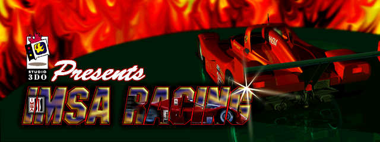
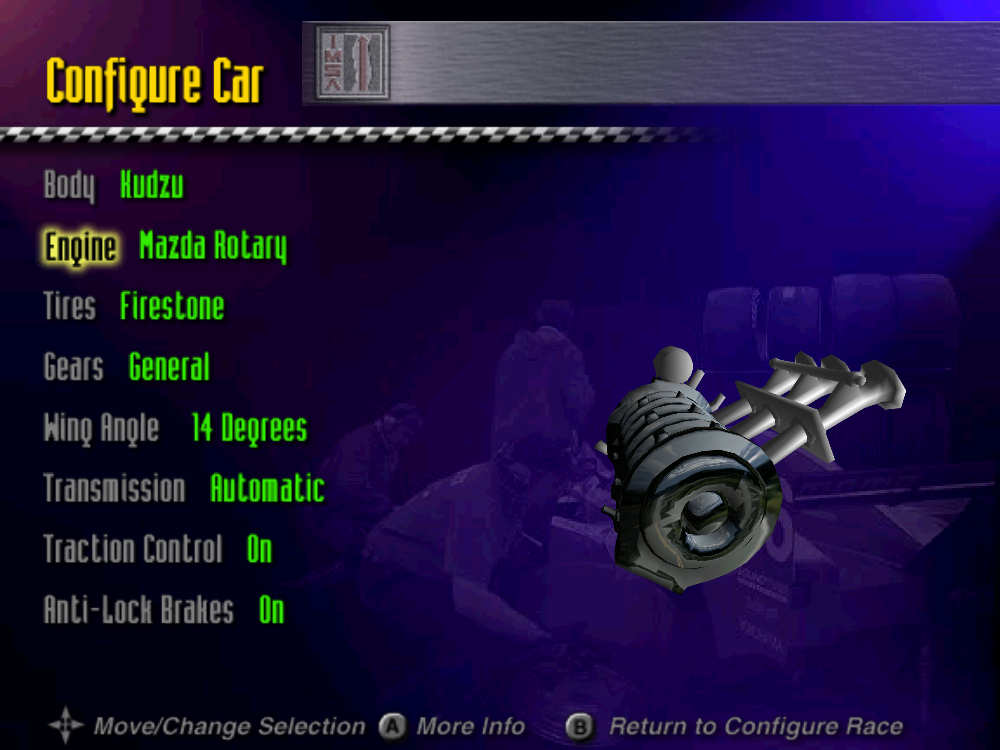
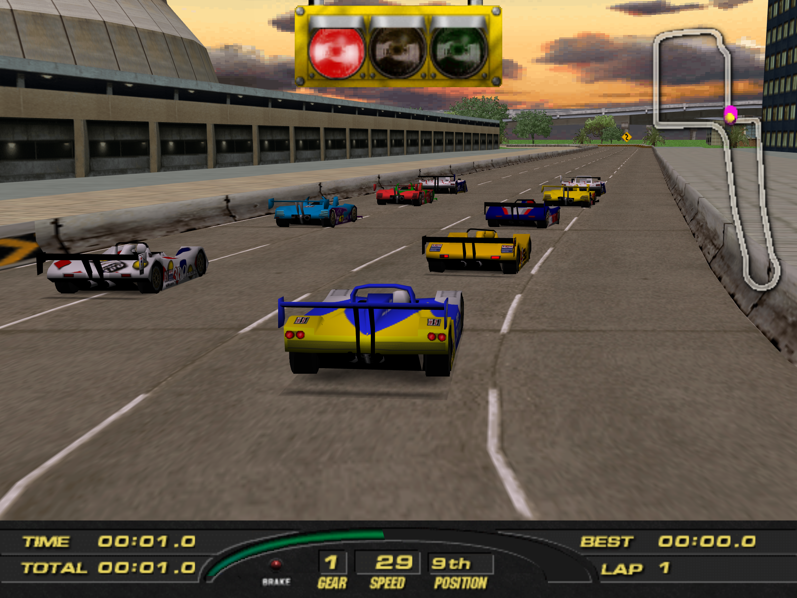
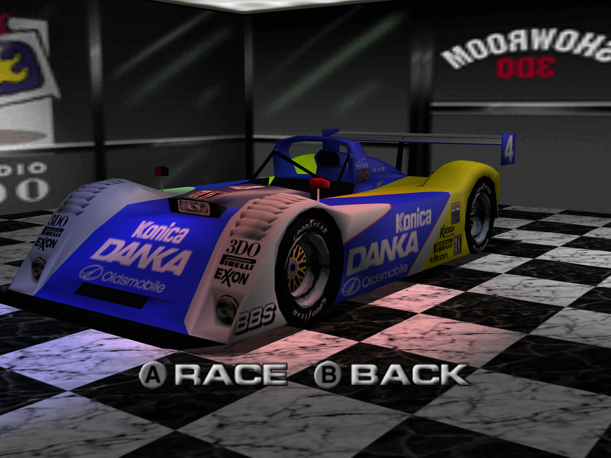

# IMSA presents World Championship Racing & shooter2d Recomp (`imsa-wcr-m2-recomp`)



This project is a static recompilation of the unreleased *IMSA presents World Championship Racing* and its on-disk companion game *shooter2d* for the unreleased Panasonic M2. This recomp has been designed to be as faithful to the original experience as possible while stopping short of being an emulator.

<p align="center">
  
  
  
</p>

---

## Quick Start

See [the Releases page](https://github.com/rsantos722/imsa-wcr-m2-recomp/releases) to download the latest release for Windows, macOS, or Linux. On first run, the launcher asks for your IMSA ISO and copies the files it needs from it.

To build yourself, see [BUILDING.md](BUILDING.md).

```sh
# Configure with your ISO build
cmake -S . -B build -DIMSA_DISC=/path/to/imsa.iso
cmake --build build --parallel 4

# Run the desktop launcher
./build/launcher/m2launcher

# Or run the host directly
./build/host/m2host
```

---

## Updating

Saves, launcher settings and the game files extracted from your disc are kept apart from the program, so an update never needs your disc again.

| Package | Update | Your data is in |
|---|---|---|
| macOS `.dmg` | Replace the app in Applications | `~/Library/Application Support/imsa-wcr-m2-recomp` |
| Linux `.AppImage` | Replace the file | `~/.local/share/imsa-wcr-m2-recomp` |
| Windows `.zip` | Extract the new version, copy the old `userdata` folder into it | `userdata` in the package folder |
| Linux `.tar.gz` | Extract the new version, copy the old `userdata` folder into it | `userdata` in the package folder |

---

## About the Project

The goals of this project were:

1. Create an authentic playable version of both IMSA and shooter2d for modern hardware. While this is not an emulator, extensive research and care has been taken to preserve the original experience as much as possible, while still providing modern conveniences.
2. Add optional bug fixes.
3. Add optional enhancements, including restoring unfinished features and general gameplay improvements.

## Features

- **A recomp focused on accuracy:** While this is not an emulator, a huge amount of research and care has gone into preserving the original experience.
- **Control Enhancements:** The controls are famously not very good in the original game. Additionally, the in-game control options do not function at all. The recomp allows you to either try the original control profile, a patched profile that makes the in-game settings work, or a Custom profile that binds directly to in-game options. In addition, an option for overhauled analog controls is available, which is a from-scratch rewrite using live physics calculations.
- **Toggle-able Bug Fixes, Enhancements, and Restored Features:** All fixes or enhancements to the original game can be toggled on or off. Additionally, some unfinished features still present on-disc have been restored.
- **Launcher:** The launcher includes setup, graphics and control configuration, toggles for bug fixes and enhancements, save data management, an option to launch into either IMSA Racing or shooter2d directly, and a 3D car model viewer.

In addition, this repo contains a large amount of documentation of the internal game and 3DO M2 based on the research completed. View the documentation map at [docs/README.md](docs/README.md).

---

## Credits & Special Thanks

- [Video Game Esoterica](https://www.youtube.com/channel/UCn2pQB4jsCTLUtx2NIkCvUg) for his extensive amount of footage of the game running on real hardware on YouTube.
- [**MAME**](https://www.mamedev.org): the Konami M2 driver ([`konamim2.cpp`](https://github.com/mamedev/mame/blob/master/src/mame/konami/konamim2.cpp), [`3dom2_te.cpp`](https://github.com/mamedev/mame/blob/master/src/mame/konami/3dom2_te.cpp)) was used as a reference for the Triangle Engine and the vertex-retention logic (`host/graphics/te_vertex_state.h`).
- [3dodev.com](https://3dodev.com)'s archive of the 3DO M2 Mercury Programmer's Guide and 3DO M2 Command List Toolkit.
- [trapexit](https://github.com/trapexit)'s archive of Portfolio OS reference materials ([`portfolio_os_m2`](https://github.com/trapexit/portfolio_os_m2)) and 3DO SDK ([`3DO-information`](https://github.com/trapexit/3DO-information)).
- [**OperaFS[De]Compiller**](https://altmer.arts-union.ru/3DO/3do_utils.htm), [**ripto2048**](https://altmer.arts-union.ru/3DO/3do_utils.htm), and [**4DO**](https://fourdo.com) which were invaluable development tools during the research process.
- These open source projects that the project depends on: [SDL](https://github.com/libsdl-org/SDL), [FFmpeg](https://ffmpeg.org), [wxWidgets](https://www.wxwidgets.org), [stb_vorbis](https://github.com/nothings/stb), and [Capstone](https://www.capstone-engine.org). See [THIRD_PARTY_NOTICES](THIRD_PARTY_NOTICES) for licenses.
- **Original Development Team**: See [ORIGINAL_CREDITS.md](ORIGINAL_CREDITS.md).
- Additional references used were patent [WO1996036011A1](https://patents.google.com/patent/WO1996036011A1) (Triangle Engine), [PowerPC 602 User's Manual](https://zxgit.org/RomanRom2/awesome-cpus/raw/commit/8115b6c97d547c13037b0cfcb0125d09a3e90543/PowerPC/PowerPC_602/manual.pdf), and [NXP PowerPC Floating-Point Documentation](https://www.nxp.com/docs/en/user-guide/MPCFPE_AD_R1.pdf).

---

## License

The code and documentation in this repository are released under the [MIT License](LICENSE). This project does not include the original game.