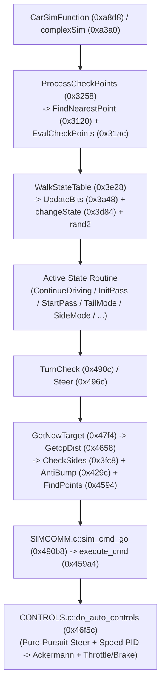

# Opponent AI, Racing Line Splines, State Tables, and Control Handoff

## `ai.c` Function Inventory and Pipeline

`ai.c` owns both race-wide checkpoint/lap ranking (for the player and up to 9 AI opponents) and the table-driven AI driver state machine.

### Complete `ai.c` Function Table (`0x3120..0x7138`)

| Function | `.text` Offset (VA) | Size | FP Ops | Role |
| --- | --- | ---: | ---: | --- |
| `FindNearestPoint` | `0x3120` (`0x103120`) | 140 B | 12 | Finds closest `TRKM` track-centerline waypoint to car position |
| `EvalCheckPoints` | `0x31ac` (`0x1031ac`) | 144 B | 5 | Advances checkpoint index and lap count on sector crossings |
| `CrossProduct` | `0x323c` (`0x10323c`) | 28 B | 6 | 2D XZ cross product helper for line-crossing tests |
| `ProcessCheckPoints` | `0x3258` (`0x103258`) | 928 B | 10 | Refreshes coarse car pose `(X, Y, -Z)`, updates lap/checkpoint state and race messages |
| `InitStateTableVars` | `0x35f8` (`0x1035f8`) | 64 B | 0 | Resets state-machine globals at race initialization |
| `WinTie` | `0x3638` (`0x103638`) | 188 B | 12 | Breaks tie between two cars on the same lap and checkpoint |
| `RankOppPositions` | `0x36f4` (`0x1036f4`) | 444 B | 0 | Sorts opponent relative longitudinal order |
| `InBack` / `InFront` | `0x38b0` / `0x39ac` | 252 / 156 B | 0 | Queries nearest rival behind or ahead of the subject car |
| `UpdateBits` | `0x3a48` (`0x103a48`) | 828 B | 52 | Builds situation bitmask (proximity, speed delta, pass corridors, track zone) |
| `changeState` | `0x3d84` (`0x103d84`) | 164 B | 0 | Updates `racer+0x50` (state ID) and `racer+0x54` (handler function pointer) |
| `WalkStateTable` | `0x3e28` (`0x103e28`) | 416 B | 0 | Matches situation word against personality table and transitions via weighted RNG draw |
| `CheckSides` | `0x3fc8` (`0x103fc8`) | 724 B | 82 | Lateral avoidance: shifts target lane by `±0.25` when a rival is within `15` units in X |
| `AntiBump` | `0x429c` (`0x10429c`) | 216 B | 28 | Longitudinal closing-speed brake/throttle modulation to prevent rear-ending |
| `CheckForSafePass` | `0x4374` (`0x104374`) | 332 B | 39 | Vetoes pass initiation if a car occupies the `(-15..15) x (-23..23)` safety box |
| `DoBumperCheck` | `0x44c0` (`0x1044c0`) | 12 B | 0 | Thunk wrapper for bumper proximity check |
| `GetD` | `0x44cc` (`0x1044cc`) | 64 B | 13 | Computes perpendicular distance to a 2D line |
| `CalcLineOffset` | `0x450c` (`0x10450c`) | 136 B | 18 | Computes normalized lateral lane fraction `t` across road strip width |
| `FindPoints` | `0x4594` (`0x104594`) | 196 B | 24 | Interpolates 3D world point between left (`tdp+0`) and right (`tdp+8`) boundary rails |
| `GetcpDist` | `0x4658` (`0x104658`) | 412 B | 38 | Reloads authored racing-line fraction, applies `CheckSides` offset, computes look-ahead |
| `GetNewTarget` | `0x47f4` (`0x1047f4`) | 280 B | 34 | Advances look-ahead waypoint along track and computes 3D aim point |
| `TurnCheck` | `0x490c` (`0x10490c`) | 96 B | 9 | Scales target speed for upcoming corner curvature and nearby slow player |
| `Steer` | `0x496c` (`0x10496c`) | 112 B | 6 | Finalizes target point (`racer+0x18..0x20`) and speed requests for `sim_cmd_go` |
| `ContinueDriving` | `0x49dc` (`0x1049dc`) | 748 B | 37 | **State 0**: Nominal racing-line following |
| `Avoid` | `0x4cc8` (`0x104cc8`) | 380 B | 24 | **State 1**: Emergency obstacle/traffic evasion |
| `Coast` | `0x4e44` (`0x104e44`) | 172 B | 14 | **State 2**: Off-throttle coasting through congestion |
| `InitPass` | `0x4ef0` (`0x104ef0`) | 520 B | 43 | **State 3**: Selects pass side and runs `CheckForSafePass` |
| `StartPass` | `0x50f8` (`0x1050f8`) | 780 B | 83 | **State 4**: Commits to passing lane offset (`0.1` or `0.9`) |
| `FinishPass` | `0x5710` (`0x105710`) | 672 B | 61 | **State 5**: Merges back onto optimal racing line after clearing rival |
| `InitRecovery` | `0x59b0` (`0x1059b0`) | 236 B | 31 | **State 6**: Enters off-track / spin recovery mode |
| `Recover` | `0x5a9c` (`0x105a9c`) | 260 B | 27 | **State 7**: Low-speed return-to-track steering |
| `GiveChance` | `0x5ba0` (`0x105ba0`) | 352 B | 22 | **State 8**: Yields/holds line for competitive pacing |
| `WaitPass` | `0x5d00` (`0x105d00`) | 292 B | 20 | **State 9**: Holds behind rival when `CheckForSafePass` rejects an overtake |
| `InitTail` | `0x5e24` (`0x105e24`) | 476 B | 20 | **State 10**: Sets up slipstream/tailing behind leading car |
| `GetDistFromEndPointAlongLine` | `0x6000` (`0x106000`) | 144 B | 23 | Longitudinal projection along track segment |
| `CalcLineFromPos` | `0x6090` (`0x106090`) | 144 B | 23 | Constructs 2D line coefficients from two XZ points |
| `GetDists` | `0x6120` (`0x106120`) | 48 B | 0 | Helper returning line distance projections |
| `GetABC` | `0x6150` (`0x106150`) | 220 B | 19 | Fits implicit line equation $Ax + By = C$ |
| `TailMode` | `0x622c` (`0x10622c`) | 936 B | 83 | **State 11**: Active drafting/tailing behavior |
| `InitSide` | `0x65d4` (`0x1065d4`) | 340 B | 18 | **State 12**: Enters side-by-side racing mode |
| `SideMode` | `0x6728` (`0x106728`) | 760 B | 83 | **State 13**: Maintains parallel lane spacing alongside a rival |
| `WeakPass` | `0x5404` (`0x105404`) | 780 B | 83 | **State 14**: Cautious/partial overtake |
| `RankRacers` | `0x6a20` (`0x106a20`) | 804 B | 12 | Computes overall race standings (1st..10th) across all cars |
| `HandleDrafting` | `0x6d44` (`0x106d44`) | 472 B | 56 | Evaluates slipstream cone behind ahead cars and boosts top speed / reduces drag |
| `LoadPersonalities` | `0x6f1c` (`0x106f1c`) | 144 B | 0 | Assigns personality programs (`MissionRoutines`) to each opponent at track init |
| `StuffDataIn` | `0x6fac` (`0x106fac`) | 44 B | 4 | Copies target/speed fields into a command struct |

## Track Centerline (`TRKM`) and Racing Line Geometry

AI reads centerline position, situation bits, and authored lane fractions from the [track line tables](../formats/track.md#line-tables-and-lane-fractions). `FindPoints` interpolates between the left and right boundary rails using the selected lane fraction.

### Coordinate Refresh (`ProcessCheckPoints`, `0x3258`)

For each car, `ProcessCheckPoints` (`0x327c..0x32c8`) reads the latest published physics pose from `simoutput` (`copy_output_data` at `0x45768`) and updates the racer's coarse position at `racer + 0x24 (X)`, `+0x28 (Y)`, and `+0x2c (-Z)` (negating $Z$ to match the track's left-handed coordinate frame). When a car crosses the finish or white-flag thresholds, `ProcessCheckPoints` triggers HUD and voiceover notifications (`"White Flag. Last Lap."`, `"Race Won"`, `"Player Car Finished"` at `0x70c8..0x7112`).

## State Table Dispatch and Driver Personalities (`WalkStateTable`, `0x3e28`)

### Racer AI Record Layout (`racers` at `.bss + 0x3a60`, stride `0x124` = 292 bytes)

| Offset | Type | Field / Role |
| --- | --- | --- |
| `+0x18 .. +0x20` | `float[3]` | Current 3D target aim point `[tx, ty, tz]` |
| `+0x24 .. +0x2c` | `float[3]` | Coarse world position `[X, Y, -Z]` refreshed by `ProcessCheckPoints` |
| `+0x38`, `+0x3c` | `uint32_t` | Timing counters whose sum is compared against the track reload threshold at `0x0017757C` (see [Timing, Crash Recovery, and Replays](race-rules.md#timing-crash-recovery-and-replays)) |
| `+0x50` | `int32_t` | Current AI state index (`0..14`) |
| `+0x54` | `void (*)(Racer *)` | Current AI state routine pointer (indexed from `stateStarts` at `.data + 0x54`) |
| `+0x60` | `int32_t` | Selected car visual variant (`0..2` for AI opponents, `0` for player by default) |
| `+0x68` | `uint32_t` | Held-lane lock flag (when non-zero, suppresses `TRKM` lane reload) |
| `+0x6c` | `float` | Desired lateral lane fraction (`0.0` = left rail, `1.0` = right rail) |
| `+0x7c` | `uint32_t` | Latched state/event bitmask (e.g., `0x01000000` set on rejected `InitPass`) |
| `+0x80` | `uint32_t` | Current target rival / prospective pass partner racer index |
| `+0x8c` | `SimRecord *` | Pointer to the vehicle's simulator command/state record |
| `+0x90` | `PersonalityEntry *` | Pointer to assigned personality state-transition table (`MissionRoutines`) |
| `+0x108` | `uint32_t` | Wait cooldown timer (set to 200 on rejected pass, decremented only by `WaitPass`) |

### Situation Word Construction and Weighted State Selection

1. **Situation Word**: Each tick, `WalkStateTable` builds a 32-bit `situation` word for the car:
   $$
   \text{situation} = \text{UpdateBits}(\text{racer}) \;\mid\; \text{racer}[\text{+0x7c}] \;\mid\; \big(\text{stuckCnt}[i] > 50 \;\text{?}\; \text{0x00080000} : 0\big)
   $$
   where `stuckCnt` is the per-car low-speed counter array at `.data + 0x5d24` (`0x0017BD94`), incremented each frame in `trackIterate` (`0x19224+`) while a car's speed stays below threshold and reset to `0` once it exceeds `50` ticks and injects `0x00080000` ("held too long / stuck").
2. **28-Byte Personality Table Matching**:
   - Each personality program (`racer + 0x90`, assigned by `LoadPersonalities` from `.data` tables such as `0x0017654C`) consists of 28-byte rows for the current state:
     - `+0x00`: Source state index (lowest bit set on the final row of a block).
     - `+0x04`: `expected` situation bits.
     - `+0x08`: `mask` of situation bits to test.
     - `+0x0c .. +0x1a`: 15 transition probability weights (bytes summing to `100`) mapping to the 15 AI states (`0..14` in `MissionRoutines+0x90` order).
   - `WalkStateTable` tests `(situation ^ expected) & mask == 0`. On the first matching row, it draws a random decision index via `rand2()` (`0x261ac`):
     $$
     \text{draw} = \left\lfloor \frac{\text{rand2}() \bmod 201}{2} \right\rfloor = (\text{rand2}() \bmod 201) \gg 1 \;\in\; [0, 100]
     $$
     The routine accumulates the 15 weights into stack slots `stack[0..15]` (where `stack[0] = 0` and `stack[k] = \sum_{i=0}^{k-1} \text{weight}[i]`). The selection loop (`0x3f3c..0x3f8c`) picks state $k-1$ on the half-open interval:
     $$
     \text{stack}[k-1] \le \text{draw} < \text{stack}[k]
     $$
     and transitions to the selected state via `changeState`.
   - **Decision Index and `draw == 100` Edge Case**:
     - Each row's 15 weights sum to `100` (covering $[0, 99]$), so `stack[15] <= 100`. However, `0x3f20..0x3f30` (`li r12, 201; divw; mullw; subf; srawi r7, r3, 1`) yields `draw = 100` when `rand2() % 201 == 200` ($1/201 \approx 0.4975\%$ per draw).
     - Because `0x3f44..0x3f5c` requires strict `draw < stack[k]`, `draw == 100` matches no interval (even when a state has weight `100`). `WalkStateTable` (`0x3f90..0x3f98`) then advances `r29 += 0x1c` (`beq 0x3ecc`) to the next matching row—or the unconditional default row—and draws a fresh `rand2()` value.

## Lateral Avoidance, Passing Safety, and Target Generation

### Passing Safety Box (`CheckForSafePass`, `0x4374`)

When `InitPass` (`0x4ef0`, State 3) evaluates whether an overtake is safe, `CheckForSafePass` transforms nearby rivals' published positions into the subject car's local frame and rejects the pass if any rival lies strictly inside the local rectangle:

$$
X_{\text{local}} \in (-15.0, +15.0), \qquad Z_{\text{local}} \in (-23.0, +23.0)
$$

A rejected pass executes the following in `InitPass` (`0x5028..0x5038`):
1. **Latches the unsafe flag**: `racer+0x7c |= 0x01000000`.
2. **Arms the cooldown timer**: `racer+0x108 = 200` (200 ticks = ~3.33 seconds at 60 Hz).
3. **Preserves pass context**: Retains the prospective pass partner (`racer+0x80`) and current lane fraction (`racer+0x6c`).

#### How an Unsafe Pass Can Still Start (`draw == 100`)

Under nominal conditions, on the subsequent state evaluation `WalkStateTable` evaluates State 3 with situation bit `0x01000000` set:
- In the opponent personality program (for example, personality `0x176d64` row 10 at `0x176e7c` or `0x17654c` row 10), the unsafe-pass row matches with `expected = 0x01000000` and `mask = 0x01000000`.
- This row assigns a weight of `100` exclusively to State 9 (`WaitPass` at `0x5d00`), intending a transition into `WaitPass` where the car holds back in its current lane and decrements `racer+0x108`.

When the `draw == 100` edge case triggers (~0.5% chance):
1. Row 10 (`0x176e7c`) fails to select State 9 because cumulative weight `100` cannot strictly exceed `draw = 100`.
2. `WalkStateTable` treats row 10 as unselected (`r30 == 0`), skips past row 11 (abort check `0x00040000`), and falls through to row 12 (`0x176eb4`, the default unconditional row with `expected = 0, mask = 0`).
3. Row 12 matches, performs a fresh `rand2()` call, and can select State 4 (`StartPass` at `0x50f8`), starting an overtake despite `CheckForSafePass` having just flagged the corridor as occupied.

### Side Avoidance (`CheckSides`, `0x3fc8`) and Outward Lane Shift (`GetcpDist`, `0x4658`)

1. **Rival Side Check (`CheckSides`)**:
   - Iterates over all active racers in array order. For each rival that passes the coarse distance check and lies within $|X_{\text{local}}| < 15.0$ laterally and the longitudinal overlap window, `CheckSides` sets a lateral lane correction of `+0.25f` (if the rival is to the left) or `-0.25f` (if the rival is to the right).
   - Because `CheckSides` overwrites the correction variable on each qualifying rival rather than picking the closest distance, the last qualifying racer in the loop wins.
2. **Lane Reload and Outward Shift (`GetcpDist`)**:
   - Reloads `racer + 0x6c` from `TRKM[currentIndex] + 0x10` when `phase >= 3`, `track_mode <= 3`, `state` is not in `{3, 4, 5, 10, 11}` (`InitPass`, `StartPass`, `FinishPass`, `InitTail`, `TailMode`), `racer + 0x68 == 0`, and `(racer[+0x38] + racer[+0x3c]) > threshold[track]`.
   - Adds the `±0.25f` side correction from `CheckSides` at `0x4720`, after comparing the *uncorrected* lane fraction against `[0.0f, 1.0f]` at `0x471c` / `0x473c`. Consequently, an in-bounds lane fraction near the edge of the road (such as `0.8632` on Testona row 3 or `0.90` during a pass) pushed outward by `+0.25` becomes `1.1132` or `1.15`, placing the interpolated 3D target point (`FindPoints`) slightly outside the boundary rail until the next clamped step.
3. **Look-Ahead and Speed Scaling (`GetNewTarget`, `TurnCheck`)**:
   - `GetNewTarget` advances along the `TRKM` spline by a speed-dependent look-ahead distance (seeded by `tweekData + 0x14 = 25.0f`, typically `80..125` world units ahead) and interpolates the 3D aim point between the left and right rails.
   - `TurnCheck` scales the requested speed based on upcoming corner flags and converts MPH-like speed targets using the factor `1.47f` ($\frac{5280}{3600} \approx 1.4667\text{ ft/s per mph}$). When near a slow human player (`|dist|^2` small), `TurnCheck` computes `(player_speed - 10.0f) * 1.47f`.

## Automatic Control Solver (`CONTROLS.c::do_auto_controls`, `0x46f5c`)

For AI opponents, `Steer` stages the 3D target point (`+0x18..+0x20`) and target throttle/brake speeds into the simulator command slot via `sim_cmd_go` (`0x490b8`). Within the world-step loop, `do_simworld` calls `do_auto_controls` (`0x46f5c`, 632 B) whenever the body decimation counter at `+0x1a0` reaches `1` and auto-control flags are active (see [Simulation Step and Body Step](physics-and-aero.md#simulation-step-and-body-step)):

1. **Pure-Pursuit Steering**:
   - Transforms the 3D world target point into the vehicle's local body frame:
     $$
     \Delta\mathbf{p}_{\text{local}} = \mathbf{M}^T(\mathbf{p}_{\text{target}} - \mathbf{p}_{\text{car}})
     $$
   - Computes the heading error angle via `asinf` (`0x4ac20`) from the ratio of lateral offset $\Delta x_{\text{local}}$ to horizontal target distance $\sqrt{\Delta x_{\text{local}}^2 + \Delta z_{\text{local}}^2}$.
   - Scales the heading error by the vehicle's steering gain (`sim + 0x12d8`) and passes the resulting centerline steer command to `calc_steering` (`0x46d30`) -> `Ackerman` (`0x46c5c`).
2. **Proportional Throttle and Brake Control**:
   - Compares the vehicle's current forward speed against `target_speed_throttle` and `target_speed_brakes`, clamping normalized throttle and brake pedal commands to `[0.0f, 1.0f]` and forwarding brake commands to `calc_brakes` (`0x46d80`).
