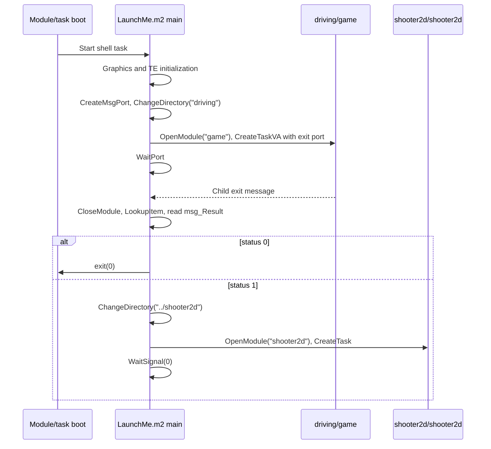

# Boot Sequence, Shell Handoff, and C Runtime Initialization

## Disc Layout and `LaunchMe.m2` (`imsa_shell.c`)

On the physical M2 CD-ROM image, `System/Scripts/startopera` ends with `$boot/AppStartup%` (an OS/ROM boot volume script). The disc root application launcher is `LaunchMe.m2` (29,511 bytes, ELF32 MSB PowerPC 602, `.hdr3do` module name `imsa_shell` at file offset `0x310`, compiled from `imsa_shell.c`).

### Shell Image and Child Launch

`LaunchMe.m2` has `.hdr3do` at file offset `0x2c0` (size `0x90`), `.text` at `0x350` (size `0x6b8`), `.data` at `0xa10` (size 8), and an empty `.bss`. ELF `e_entry` / `__start` is `.text+0x6b4`, and `imsa_shell.c::main` is at `.text+0` (332 bytes). Its `.imp3do` section at file offset `0x6c50` imports `filesystem`, `kernel`, and `graphics`.

`main` opens the Graphics Folio (`OpenGraphicsFolio` at `0x2d8`), calls `3:17`, creates and deletes a Triangle Engine I/O request (`0x1c0` / `0x278`), and then supervises its child task:

- `0x2c..0x60`: Creates `"msgport"` via `1:172`; on failure, prints an error and exits `-1`.
- `0x64..0xb4`: Calls `ChangeDirectory("driving")` (`4:7`), `OpenModule("game", 0, 0)` (`1:268`), `CreateTaskVA(module, "game", 19, port, 0)` (`1:83`), and `WaitPort(port, 0)` (`1:130`). Tag 19 registers the child exit-message port; no `ARGC`/`ARGP` tags are passed by the shell.

### Child Exit Handoff

At `0xbc..0xe0`, the shell closes the module (`1:269`), looks up the wake message (`1:34`), and reads `msg_Result` at `+0x28`:
- **Status `0`**: Calls `exit(0)`.
- **Status `1`**: Triggers the [Skid Pad shooter handoff](tracks.md#skid-pad-trigger-volumes). At `0xf0..0x140`, the shell changes directory to `../shooter2d`, opens `shooter2d`, prints `"about to create shooter2d task"`, spawns the task (`1:553`), and waits on signal mask `0` (`1:166`).

## `driving/game` Link Map and C Runtime Startup

`driving/game` is the main 3DO M2 ELF32 MSB executable (1,831,772 bytes on disc, with 1,365 lifted functions across `.text`). Its `.text`, `.data`, and `.bss` load addresses are listed in the [Guest Virtual Address Space Map](../recompilation/runtime.md#guest-virtual-address-space-map), and its register conventions follow the [Diab Data PowerPC ABI](../m2/ppc602.md#architectural-registers-and-abi).

### `__start` (`0x74134`, VA `0x174134`) and `main` (`0x1ef6c`, VA `0x11ef6c`)

1. **`__start` (`0x174134`)**: Initializes the 3DO C runtime environment and transfers control to `main(argc, argv)` (`FN_main__1ef6c`, 492 bytes).
2. **Memory Arena Initialization (`mem_init` at `0x125cb4`)**:
   - `main` immediately calls `mem_init`, which invokes `AllocMem(0x5b8d80, ...)` (`1:2` at `0x25cd0`) to reserve a 6,000,000-byte (~5.72 MiB) arena from the OS heap (`0x00400000+`), partitioning it into custom zones via `mem_define_zone`.
3. **Game Data Pointer (`GDP`) Initialization (`0x1ef98..0x1eff0`)**:
   - Stores the address of the global game context structure (`0x00182b48`) into the global pointer `.bss+0x3a54` (`0x00184cf4`, referred to as `GDP`).
   - Zeroes the structure via `memset` (`1:33` at `0x1efb4`).
   - Sets default display mode byte `GDP+0x61 = 1` (320×240) and `GDP+0x2188 = 2`.
4. **Command-Line Argument Parsing (`Parse_Args` at `0x11e7b8`)**:
   - `Parse_Args(argc, argv)` (1,972 bytes, containing 3 embedded switch jump tables at `0x1e864` [25 arms], `0x1ebac` [8 arms], and `0x1ed0c` [8 arms]) parses developer override flags when `argc > 1`:
     - `-T<track_path>`: Writes the track base path pointer (e.g., `data/tracks/testona/ra_test`) to `GDP+0x54` (and `GDP+0x58`), bypassing the UI track selector.
     - `-V`: Sets `GDP+0x5c = 1` (track viewer / flythrough mode).
     - `-Vg`: Sets `GDP+0x5c = 2`.
     - `-Vt`: Sets `GDP+0x5c = 3`.
     - Display resolution flags update `GDP+0x61` (`1..4` for 320×240, 640×240, 320×480, 640×480).
   - On a standard boot via `LaunchMe.m2`, `argc == 0` and `argv == NULL`, leaving `GDP+0x5c = 0`.
5. **Display and GState Initialization (`Dsply_InitDisplay` at `0x111a94`)**:
   - Switches on `GDP+0x61` to call `Dsply_InitDisplay` with the chosen resolution and framebuffer parameters.
   - `Dsply_InitDisplay` opens the Graphics Folio (`OpenGraphicsFolio` at `0x173e54`), creates the `GState` command-list context (`GS_Create` / `GS_AllocLists` / `GS_AllocBitmaps`), configures views, and sets up the double-buffered color targets (`0x476000` and `0x4f0000`) and 16-bit Z-buffer (`0x56a000`).
   - If `Dsply_InitDisplay` returns `0`, `main` logs an error via `printf` (`1:309`) and calls `exit(-1)` (`1:8`).
6. **Audio Folio and Soundtrack Thread Initialization (`0x1f0ec..0x1f114`)**:
   - Calls `OpenAudioFolio` (`0x73de8`, VA `0x173de8`), which resolves the Audio Folio via `FindCurrentModule` (`1:262`) followed by `ImportByName(module_item, "audio")` (`1:103`). A negative return value aborts `main` at `0x1f0f4` with `r3 = -1`.
   - Spawns the background soundtrack streaming thread (`FN_soundtrack_thread_func` at `0x28108` via `CreateThread` `1:555` at `0x28a6c`), synchronizing startup with `AllocSignal` (`1:144` at `0x28a1c`), `WaitSignal(0x400)` (`1:166` at `0x28aa0`), and `FreeSignal` (`1:143` at `0x28ab8`).
   - Calls `sndInit3DSounds` (`0x29bd8`) to initialize 3D positional audio instruments.
7. **Storage, Video, and Mercury Renderer Startup (`0x1f118..0x1f12c`)**:
   - `InitMicroCardStuff`: Initializes memory card / NVRAM storage state.
   - `MPS_InitMPEGStill`: Initializes the MPEG still image decoder used for menu backdrops (`*.mpf`).
   - `MS_Global_init`: Initializes the Mercury 3D engine globals, querying CPU cache line geometry via `GetCacheInfo` (`1:38` at `0x1b45c`) and allocating aligned scratch buffers via `AllocMemMasked` (`1:35` at `0x5f664`).
8. **Master State Loop (`StateDriver` at `0x12fa4c`)**:
   - Transfers control to `StateDriver` (`0x2fa4c`), which runs the game's main loop across all menus, showroom, race simulation, and post-race states until exit.
9. **Shutdown (`0x1f134..0x1f154`)**:
   - When `StateDriver` returns, `main` runs `MS_Global_close`, tears down the MPEG still decoder, stops the soundtrack thread (`sndShutdownThread`), closes the Audio Folio (`CloseAudioFolio` at `0x173220`), tears down the display (`Dsply_TearDownDisplay`), releases the memory arena (`mem_close`), and returns `0`.

## `shooter2d/shooter2d` External Interface

`shooter2d/shooter2d` contains 717 `R_IMPREL24` import call sites across 114 caller functions, resolving 134 distinct `(module, ordinal)` pairs across 7 `.imp3do` import modules (see [`shooter2d` Reference](shooter2d.md)):

| `.imp3do` Index | Module Name | 3DO Module ID | Host Folio ID | Distinct Vectors | Total Call Sites | Key Imported Routines |
|---:|---|---:|---:|---:|---:|---|
| 0 | `filesystem` | 3 | 4 | 11 | 49 | `OpenFile`, `CloseFile`, and raw-file reads/writes |
| 1 | `kernel` | 1 | 1 | 77 | 586 | Memory, task/thread, timer, message port, and standard C library routines |
| 2 | `iff` | 9 | 2 | 16 | 28 | IFF chunk parsing (`ParseIFF`, `ReadChunk`, `FindContextInfo`) |
| 3 | `gstate` | 17 | 8 | 10 | 13 | Command-list management (`GS_Create`, `GS_SendList`, `GS_WaitIO`) |
| 4 | `graphics` | 14 | 3 | 1 | 1 | `AddViewToViewList` (ordinal 3) |
| 5 | `font` | 8 | 9 | 3 | 5 | `CreateTextState` (#0), `DeleteTextState` (#1), `DrawText` (#2) |
| 6 | `audio` | 10 | 6 | 16 | 35 | Instrument, sample, attachment, and knob control |

## Host Boot Adaptation

At startup, the host verifies the ELF sections against the disc manifest, applies relocations, and launches the entry module (see [Startup Image Loading and Relocation Fixup](../recompilation/runtime.md#startup-image-loading-and-relocation-fixup) and [Supplying the Game Data](../../BUILDING.md#2-supplying-the-game-data)). Default shell boot stages an empty `argv` for `LaunchMe.m2` while forwarding any developer command-line arguments to `driving/game`; setting `M2_BOOT_APP=game` or `M2_BOOT_APP=shooter2d` boots the selected child executable directly.
