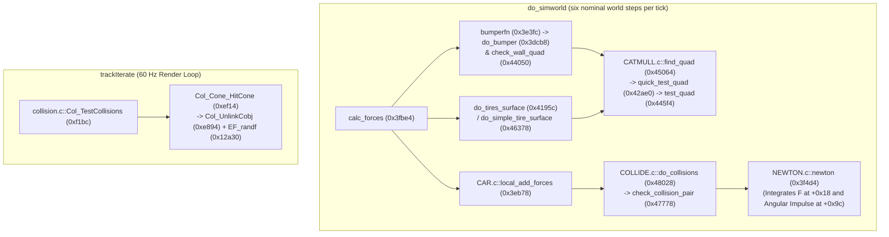

# Collision Detection, Impulse Resolution, Track Mesh, and Bumpers

## Car-vs-Car Pairwise Impulse Solver (`COLLIDE.c` / `8COLLIDE.c`)

`COLLIDE.c` (`0x47208..0x48028`, 7 functions, 3,872 B `.text`) computes pairwise car-to-car polygon clipping and injects linear force and body-frame angular impulses between force accumulation (`calc_forces`) and Euler integration (`newton`).

### Function Inventory

| Function | `.text` Offset (VA) | Size | FP Ops | Role |
|---|---|---:|---:|---|
| `init_collisions` | `0x47208` (`0x147208`) | 396 B | 28 | Initializes OBB bounds, `0.99f`-scaled local XZ quad, broadphase radius, and impulse scales |
| `untransform_multiples` | `0x47394` (`0x147394`) | 164 B | 27 | Transforms an array of 3D points from world space into a car's local frame |
| `transform_multiples` | `0x47438` (`0x147438`) | 176 B | 27 | Transforms an array of 3D points from a car's local frame into world space |
| `isect_plane` | `0x474e8` (`0x1474e8`) | 264 B | 32 | Clips a polygon edge against an axis-aligned bounding plane |
| `calc_area` | `0x475f0` (`0x1475f0`) | 392 B | 45 | Computes polygon area `0.5f * \|sum(v[i] x v[i+1])\|` via closed fan cross products |
| `check_collision_pair` | `0x47778` (`0x147778`) | 2,224 B | 306 | Clips Car A's quad against Car B's box, computes overlap area, normal, closing speed, and impulses |
| `do_collisions` | `0x48028` (`0x148028`) | 256 B | 8 | Broadphase sphere test and pairwise dispatcher called by `CAR.c::local_add_forces` (`0x3eb78`) |

### Per-Car Collision Setup (`init_collisions`, `0x47208`)

`init_collisions` reads the car's embedded configuration block pointer from `*(sim + 0x428)` (populated from `racer + 0x1b4` by `sim_cmd_init` at `0x4904c` from one of the four vehicle templates at `.data+0x3a58`, `+0x2f58`, `+0x43b0`, `+0x2360`):

| `sim` Offset | Source in `*(sim+0x428)` | Type | Description |
|---:|---:|---|---|
| `sim + 0x1218 .. 0x1220` | `config + 0x114` | `float[3]` | Local bounding box minimum `(lo.x, lo.y, lo.z)` (Class 0: `(-2.55, -1.0, -4.375)`) |
| `sim + 0x1224 .. 0x122c` | `config + 0x120` | `float[3]` | Local bounding box maximum `(hi.x, hi.y, hi.z)` (Class 0: `(2.55, 3.0, 5.125)`) |
| `sim + 0x1230` | `config + 0x12c` | `float` | Overlap area-to-impulse scale factor (Class 0: `50000.0f`) |
| `sim + 0x1234` | `config + 0x130` | `float` | Closing-contact damping/restitution coefficient (Class 0: `0.05f`) |
| `sim + 0x1238` | Computed | `float` | Maximum corner radius `max_len` (also writes `max_len` to `car+0x3e0+0x28` and `4.0f * max_len^2` to `+0x2c`) |
| `sim + 0x123c .. 0x126b` | Computed (`0.99f * box`) | `float[4][3]` | Local 4-corner XZ footprint quad in winding order: `(lo.x, 0, hi.z)`, `(hi.x, 0, hi.z)`, `(hi.x, 0, lo.z)`, `(lo.x, 0, lo.z)` |
| `sim + 0x126c .. 0x129b` | Runtime per-step | `float[4][3]` | World-transformed 4-corner quad |
| `sim + 0x12a8` | Runtime output | `float` | Unscaled impact severity `overlap_area * sim[0x1230]` (consumed by damage/audio) |
| `sim + 0x12c8` | Runtime output | `SimRecord *` | Pointer to collision partner's simulation record |

### Pairwise Clipping and Impulse Solver (`check_collision_pair`, `0x47778`)

1. **Common-Frame Transformation**:
   - Reads the two cars' simulation records (`racer + 0x3d4`).
   - Transforms Car A's world footprint quad (`sim_a + 0x126c`) into Car B's local body frame via `untransform_multiples`.
2. **2D Box Clipping and Two-Slot Clipper Behavior (`0x478d0..0x47a90`)**:
   - Clips Car A's 4-vertex polygon against Car B's `x` (`lo.x`, `hi.x`) and `z` (`lo.z`, `hi.z`) planes (`sim_b + 0x1218..0x122c`) using `isect_plane`.
   - **Acceptance Gate (`0x47a60..0x47a74`)**:
     - The stack frame allocates two 3-float intersection scratch slots (`r30` starts at `r1 + 0x3c` and saturates at `r1 + 0x54` via the guard `addi r12, r1, 0x54; cmplw r12, r30; ble` at `0x4791c..0x47924`).
     - The clipped polygon vertex-pointer array (`r26` starting at `r1 + 0x54`) increments unconditionally by 4 bytes per emitted vertex (`0x47900`, `0x47a48`).
     - The collision is accepted if and only if `r30 == r1 + 0x54` (**exactly two** plane-intersection points were generated) **and** `r26 >= r1 + 0x60` (at least three vertex pointers were emitted).
     - Any other configuration (including a quad that is completely inside the other box with zero edge intersections) increments `collision_error` at `.bss + 0x9848` (`0x0018AAE8`) and returns without applying any force.
     - If more than two edges cross the box planes, `r30` saturates at `r1 + 0x54`, truncating the polygon passed to `calc_area` while still satisfying the acceptance predicate.
3. **Overlap Area (`calc_area`, `0x475f0`)**:
   - Evaluates the closed polygon fan cross-product sum over the vertex pointer array (`r1 + 0x54 .. r26`):
     $$\mathbf{N} = \sum_{i} \left(\mathbf{v}_i \times \mathbf{v}_{i+1}\right), \qquad \text{area} = \frac{1}{2} \|\mathbf{N}\|$$
     using `sqrtf_gap` (`0x4aca0`, `frsqrte` + Newton-Raphson refinement) and returning `0.0f` if fewer than 3 vertices are present.
   - After `calc_area` returns, `check_collision_pair` overwrites `r1 + 0x54..0x5c` (`0x47b5c..0x47b84`) with the midpoint $\mathbf{m} = \frac{1}{2}(\mathbf{I}_0 + \mathbf{I}_1)$ of the two generated intersection vertices (`r1 + 0x3c` and `r1 + 0x48`).
4. **Impulse Direction, Sign Rule, and Closing-Velocity Rescale**:
   - Constructs the in-plane contact normal $\hat{\mathbf{n}} = (-\Delta z, 0, \Delta x)$ from the chord $\mathbf{I}_1 - \mathbf{I}_0$ between the two intersection points.
   - Computes raw impulse magnitude:
     $$J_{\text{raw}} = \text{area} \cdot \text{sim}[\text{0x1230}] \cdot \Delta t$$
     and records the unscaled severity $\text{area} \cdot \text{sim}[\text{0x1230}]$ at `sim + 0x12a8` and the partner pointer at `sim + 0x12c8`.
   - **Sign Rule**: If $\mathbf{I} \cdot \mathbf{m} > 0$ in Car B's frame, negates $\mathbf{I}$ so the impulse applied to Car B points toward Car B's origin.
   - **Closing-Rate Gate**: Computes the relative contact point velocity $\mathbf{v}_{\text{rel}} = (\mathbf{v}_B + \boldsymbol{\omega}_B \times \mathbf{r}_B) - \mathbf{T}_{A \to B}(\mathbf{v}_A + \boldsymbol{\omega}_A \times \mathbf{r}_A)$. When $\mathbf{v}_{\text{rel}} \cdot \mathbf{I} > 0$, scales the impulse by the average restitution/damping coefficient:
     $$\mathbf{I}_{\text{applied}} = \frac{1}{2}\Big(\text{sim}_A[\text{0x1234}] + \text{sim}_B[\text{0x1234}]\Big) \cdot \mathbf{I}$$
5. **Force and Body-Frame Torque Accumulation**:
   - Adds $\mathbf{I}_{\text{applied}}$ to Car B's linear force accumulator (`+0x18`) and subtracts the frame-transformed impulse from Car A's linear force accumulator.
   - Computes each car's contact torque in its own body frame ($\mathbf{m} \times \mathbf{I}_{\text{applied}}$ for Car B; $-\mathbf{r}_A \times \mathbf{I}_A$ for Car A) and accumulates it into the angular impulse slot (`SimObject + 0x9c..0xa4`), which `newton` (`0x3f4d4`) integrates directly into angular velocity.

## Track Quad Mesh (`CATMULL.c`) and Wall Bumpers (`CAR.c`)

Track road surfaces and corridor walls are represented by a quad mesh parsed from each track's text `.qmf` file (`M2ReadQMFFile` at `0xbba0` -> `process_qmf_data` at `0x43c7c`) and queried via `CATMULL.c` (`0x423f0..0x45064`, 25 functions, 11,680 B `.text`, 960 FP ops, 11 switch jump tables). For the `.qmf` file grammar and field types, see [`.qmf` (Quad Mesh File) Format](../formats/track.md#qmf-quad-mesh-file-format-m2readqmffile).

### `CATMULL.c` Core Functions

| Function | `.text` Offset (VA) | Size | FP Ops | Role |
|---|---|---:|---:|---|
| `calc_catmul_coeffs` | `0x423f0` (`0x1423f0`) | 220 B | 41 | Evaluates uniform Catmull-Rom cubic basis weights |
| `catm_interpolate` | `0x424cc` (`0x1424cc`) | 400 B | 78 | Interpolates 3D surface position and tangents across spline patch |
| `catmul_3D_info` | `0x4265c` (`0x14265c`) | 564 B | 84 | Computes 3D surface height and normal on curved road segments |
| `set_array_points` | `0x42890` (`0x142890`) | 520 B | — | Gathers the 4×4 local control-point patch around a `.qmf` quad |
| `setup_mesh_info` | `0x42a98` (`0x142a98`) | 72 B | 0 | Populates quad corner cache (`set_array_points`) |
| `quick_test_quad` | `0x42ae0` (`0x142ae0`) | 428 B | 67 | Fast bounding-radius test against quad centroid |
| `calc_normal` | `0x42c8c` (`0x142c8c`) | 720 B | 158 | Computes normalized triangle/quad surface normals via `quick_normalize` |
| `find_convex_diag` | `0x42f5c` (`0x142f5c`) | 452 B | 51 | Splits quad along convex diagonal for accurate contact depth |
| `calc_contact_depth` | `0x43120` (`0x143120`) | 296 B | 50 | Returns signed penetration depth against decomposed quad triangles |
| `catmul_3D` | `0x43248` (`0x143248`) | 124 B | — | Top-level 3D spline point evaluator |
| `init_contacttyp` | `0x432c4` (`0x1432c4`) | 392 B | 17 | Initializes `ContactState` from QMF range bounds |
| `restart_contact_search` | `0x4344c` (`0x14344c`) | 196 B | — | Resets cached quad pointers after a discontinuity or car relocation |
| `get_quad_center_orient` | `0x43664` (`0x143664`) | 464 B | — | Computes center position and orientation basis of a track quad |
| `set_start_pos_orient` | `0x43834` (`0x143834`) | 436 B | — | Places and aligns a car on its starting grid quad |
| `read_qmf_file` | `0x439e8` (`0x1439e8`) | 660 B | — | File-based `.qmf` parser |
| `process_qmf_data` | `0x43c7c` (`0x143c7c`) | 668 B | 23 | Parses CSV-like `.qmf` rows (`x, y, z, A..G`) and calls `set_start_pos_orient` |
| `make_quad_list` | `0x43f18` (`0x143f18`) | 312 B | — | Collects nearby wall/surface quads for collision testing |
| `check_wall_quad` | `0x44050` (`0x144050`) | 632 B | 25 | Builds nearby wall quad list (`make_quad_list`) for `bumperfn` |
| `copy_contact_data` | `0x442c8` (`0x1442c8`) | 132 B | 0 | Copies resolved contact normal/depth/material into consumer struct |
| `random_surface` | `0x4434c` (`0x14434c`) | 528 B | — | Synthesizes procedural micro-bumpy road surface perturbation |
| `add_random_surface` | `0x4455c` (`0x14455c`) | 152 B | — | Adds procedural surface roughness onto the evaluated normal/height |
| `test_quad` | `0x445f4` (`0x1445f4`) | 2,672 B | 105 | Full point-in-quad classifier (11-word `bctr` jump table at `0x44b3c..0x44b64`) |
| `find_quad` | `0x45064` (`0x145064`) | 300 B | 0 | Master surface query entry point (cache check -> `quick_test_quad` -> `test_quad`) |

### `find_quad` (`0x45064`), `quick_test_quad` (`0x42ae0`), and `test_quad` (`0x445f4`)

1. **Cache Fast-Accept (`find_quad` at `0x45084..0x450a0`)**:
   - Reads the cache lifetime byte `r29 = *(u8 *)(Q + 0x122)`. When non-zero, decrements `Q + 0x122` and immediately returns `*(CTX + 0x20)` without searching.
   - When the cache is empty, swaps `*CTX` and `CTX+4`, clears `CTX+0x20/0x21`, and either takes the `CTX+0x21` shortcut or iterates candidate quads from `CTX+0x48` using `quick_test_quad` followed by `test_quad`.
2. **Centroid Distance Filter (`quick_test_quad`)**:
   - Checks `Q[0]` against the candidate mesh node; on mismatch, calls `setup_mesh_info` and initializes `Q+0x34 = 0.5f`, `Q+0x38 = 0.5f`.
   - Computes the 4-corner centroid $\mathbf{C} = \frac{1}{4}\big(((A + C) + D) + B\big)$ from `Q + 0x78 / 0x84 / 0xa8 / 0xb4` and returns `1` iff at least one of those four corners is strictly farther from $\mathbf{C}$ than the query point $\mathbf{P}$ is ($\|\mathbf{S} - \mathbf{C}\|^2 > \|\mathbf{P} - \mathbf{C}\|^2$).
3. **4-Bit Edge Classifier (`test_quad`)**:
   - Builds a 4-bit out-of-bounds mask `m` (`r27`) across two opposing edge pairs:
     - Side A sets `0x01` when $t_A > 1.0$ (`0x44864`) or `0x02` when $t_A < 0.0$ (`0x4490c`).
     - Side B sets `0x04` (`0x449f8`) or `0x08` (`0x44ab8`).
   - Because each side's pair is mutually exclusive, only the index set $m \in \{0, 1, 2, 4, 5, 6, 8, 9, 10\}$ is reachable. For $m \neq 0$, dispatches through the 11-word jump table at `0x44b3c..0x44b64` with cyclic priority `b0 > b2 > b1 > b3` (`1≡5 -> -n0`, `2≡10 -> +n0`, `4≡6 -> -n1`, `8≡9 -> +n1`), increments `surf_search_count` at `.bss + 0x9830` (`0x0018AAD0`), and writes the updated cache lifetime to `Q + 0x122` (`0x44ff0`). The resolver writes the normal at `Q+0x28..0x30` and squared distance at `CTX+0x0c`; mask `0x20` is an auxiliary boundary flag outside the 4-bit neighbor classifier.

### Car-vs-Wall Bumper Solver (`CAR.c`: `init_bumpers`, `bumperfn`, `do_bumper`)

1. **Setup (`init_bumpers` at `0x3d71c`)**:
   - Registers `bumperfn` (`0x3e3fc`) on the car's `fconlist` via `add_fconlist(*(sim), 4)` with `payload[0] = sim`.
   - Initializes four corner bumper records at `sim + 0x42c + i * 0x370` (`i = 0..3`):
     - Copies the 3D corner offset from `config + 0xbc + i * 0x0c` (`record + 0x18`).
     - Copies stiffness/damping scalars from `config + 0xec + i * 4` (`record + 0x28`) and `config + 0xfc + i * 4` (`record + 0x2c`).
     - Initializes each corner's QMF contact tracker via `init_contacttyp` using `config + 0x1e8 .. 0x1f4`.
2. **Per-Step Wall Response (`bumperfn` at `0x3e3fc` -> `do_bumper` at `0x3dcb8`)**:
   - `bumperfn` updates wall quad lists via `check_wall_quad`, copies contact data (`copy_contact_data`), and invokes `do_bumper` (1,708 B) for each corner.
   - `do_bumper` manages a per-corner cooldown counter at `SLOT + 0x36c` and queries `find_quad`.
   - Evaluates penetration `P` (`SLOT + 0x20`) against two contact windows (`(-10.0f, 0.0f)` shallow arm and deep knock-back arm using constants `-0.5f`, `0.1f`, `-10.0f` from float pool `0x3eba4..0x3ebb8`), transforms normal/velocity vectors between world and body frames (`Vector_Multiply3x3` at `0x3d288`, `Vector_Multiply3x3I` at `0x3d250`, `normalize` at `0x4a81c`), and accumulates wall repulsion forces (`OBJ + 0x18`) and yaw/roll torques (`OBJ + 0x84`).

## Trackside Cones and Scene Props (`collision.c`)

In addition to the simulation-world collision pass (see [Simulation Step and Body Step](physics-and-aero.md#simulation-step-and-body-step)), `trackIterate` (`0x190c4`) runs a 60 Hz scene prop collision pass (`Col_TestCollisions` at `0xf1bc`) over the global car collision list (`carcobjlist` at `.bss + 0x7b0`, `0x00181A50`) and traffic cone list (`conecobjlist` at `.bss + 0x7b4`, `0x00181A54`, backed by `gConePodList` at `.bss + 0x6400`).

### Cone Impact Response (`Col_Cone_HitCone`, `0xef14`)

When a car's bounding box intersects a traffic cone, `Col_Cone_HitCone` (236 B) detaches the cone from its static placement and launches it with an impact-based velocity and random spin:

1. **Unlink and Active List Push (`0xef34..0xef58`)**:
   - Calls `Col_UnlinkCobj` (`0xe894`) to unlink the cone record (`rec[+0]` = prev, `rec[+4]` = next, `rec[+8]` = owner) from its static cell.
   - Pushes the cone record onto the active moving-cone list head at `0x00181A54` (`.bss + 0x7b4`).
2. **Launch Velocity (`0xef5c..0xefa8`)**:
   - Reads the 2D XZ position pair from the hitting object (`r6 + 0x14`, `r6 + 0x1c`) and the cone mesh (`r3 + 0x00`, `r3 + 0x08`).
   - Computes the scaled horizontal launch velocity and fixed vertical pop using `.text` constants `1.3f` (`0x10f54c`) and `2.0f` (`0x10f550`):
     $$\text{record}[\text{+0x10}] = 1.3 \cdot (\text{mesh}_x - \text{obj}_x), \qquad \text{record}[\text{+0x14}] = 2.0, \qquad \text{record}[\text{+0x18}] = 1.3 \cdot (\text{mesh}_z - \text{obj}_z)$$
3. **Random Spin (`0xefac..0xefec`)**:
   - Invokes `EF_randf(1.0f)` (`0x12a30`) **three times**, where `EF_randf` draws from the lagged-Fibonacci PRNG `rand` (`0x75848`, 55-entry state table at `0x00181198`, indices at `0x00181274 / 0x00181278`, seeded by `srand` at `0x758cc` with LCG multiplier `0x00010DCD`) and scales `(float)(rand() & 0xffff) * range * 2^-16`.
   - Subtracts `0.5f` (`0x10f534`) from each draw and writes the three random spin components in `[-0.5f, +0.5f)` to `record[+0x1c]`, `record[+0x20]`, and `record[+0x24]`.

## Car Relocation

`Crashing.c` monitors severe excursions, rollovers, and stalled recovery. `InitRestartStuff` and crash-state records include a 600-tick countdown and a restart counter. The active physical recovery path calls `CAR.c::relocate_car` (`0x3e890`, 700 bytes) rather than the dormant `flipCarUpright` (`0xe574`) helper.

`relocate_car` restarts the Catmull contact search through `restart_contact_search` (`0x4344c`), writes the restart position at `0x3e8dc..0x3e8e4`, zeroes linear and angular velocity at `0x3e8e8..0x3e8f4`, rebuilds the orientation basis, and propagates the new transform through `set_subtree_univ_pos_orient` (`0x3fa8c`).
