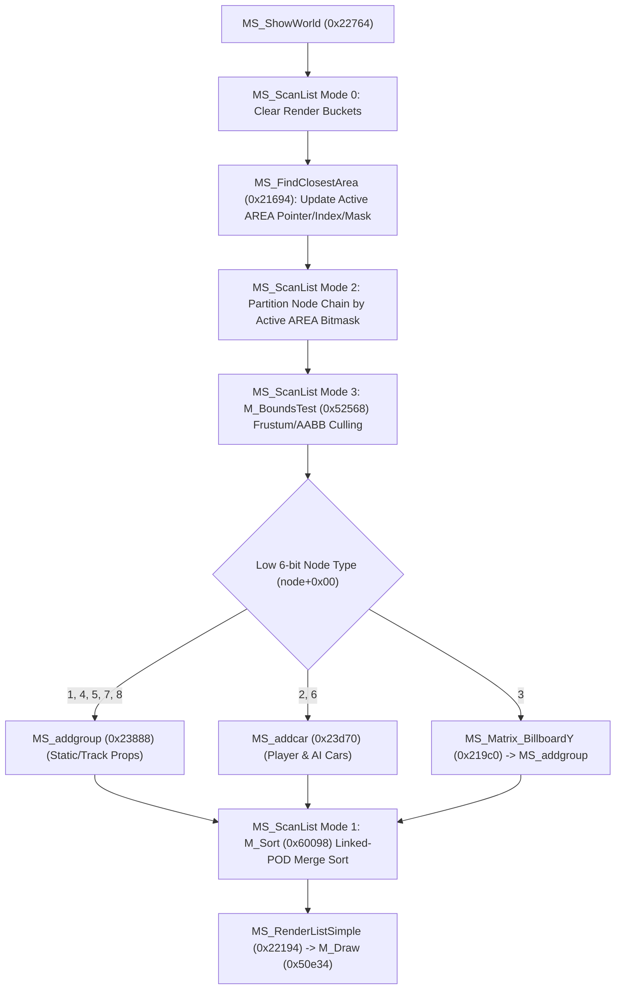

# Mercury Rendering Pipeline

## Scene Graph, Visibility Culling, and the Mercury POD Pipeline

3D world and car rendering is built on a custom fork of the 3DO M2 Mercury engine (`M_Support.c`, `M_Readers.c`, and linked `libmercury` routines).

### Mercury `Pod` Structure (9 Words / `0x24` Bytes)

Every renderable surface batch is represented by a `0x24`-byte `Pod` node:

| Offset | Field | Description |
|---|---|---|
| `+0x00` | `flags` | Render/cull flags (`samecaseFLAG = 0x00800000` bit 8, `sametextureFLAG = 0x00400000` bit 9, `nocullFLAG`, etc.) |
| `+0x04` | `pnext` | Singly-linked list pointer to the next `Pod` in the draw list |
| `+0x08` | `pcase` | Microcode/setup function pointer (`void (*)(CloseData*)`, e.g., `M_SetupDynLitTex`) |
| `+0x0c` | `ptexture` | `PodTexture*` (word `+0x00` is a callback invoked via `blrl` at `0x51484` -> `M_LoadPodTexture` at `0x5fd04` or `M_LoadPodTextureNoUpdate`) |
| `+0x10` | `pgeometry` | `PodGeometry*` (6 AABB bounds floats, `pvertex` 24B stride `[x, y, z, nx/r, ny/g, nz/b]`, `pshared`, `vertexcount`, `sharedcount`, `pindex` NEWS/STXT/CFAN/PCLK triangle strip snake, `puv`, `paaedge`) |
| `+0x14` | `pmatrix` | Pointer to 4×3 world transform matrix |
| `+0x18` | `plights` | Pointer to active light list |
| `+0x1c` | `puserdata` | User data word |
| `+0x20` | `pmaterial` | Pointer to material color/specular properties |

### Model Group Table (`MS_addgroup`, `0x23888`)
Models store an LOD/group count at `model+0x18` and an array of 12-byte group descriptors starting at `model+0x20` (`+0x20 + i*0x0c` = POD count, `+0x24 + i*0x0c` = first `Pod*`). `MS_addgroup` (144 B) clamps the requested LOD index to `count - 1`, walks the contiguous `0x24`-byte `Pod` array, links each node's `pnext` (`+0x04`), and prepends the chain to the caller's draw list head `*r5`.

### World Scan and Visibility Culling (`MS_ShowWorld`, `0x22764`; `MS_ScanList`, `0x21a68`)

`MS_ShowWorld` drives visibility culling using scan state at `0x187588` (`.bss+0x62e8`), render buckets at `0x187548` (configured by `0x17ce18`), and the loaded track world root `[0x184cf8]`:

1. **Mode 0 (Bucket Reset) and Active Area Lookup:** Clears bucket heads at `0x187548`. `MS_FindClosestArea` (`0x21694`) scans the stride-12 authored `AREA` table (`world+0x18`) and updates the active AREA pointer (`scan+0x78` = `0x187600`), index (`scan+0x80` = `0x187608`), and visibility bitmask (`scan+0x84` = `0x18760c`).
2. **Mode 2 (Area Partitioning):** Walks the scene node chain (`scan+0x04` = `0x18758c`) and partitions nodes in-place by testing each node's area membership (`node+0x14`) against the active area index and bitmask tables (`world+0x74`, `world+0x78`).
3. **Mode 3 (Frustum Culling, LOD Selection, and Node Dispatch):**
   - Runs `M_BoundsTest` (`0x52568`) on `scan+0x20` (`0x1875a8`).
   - Rejects nodes with nonzero high flag bits `8..25`, then switches on the low 6 bits of `node+0x00` (`rlwinm r30, r3, 0, 26, 31`):
     - **Types 1, 4, 5, 7, 8:** Static world geometry and trackside props; distance-culled in the XZ plane (`sqrtfff(dx^2 + dz^2)` vs integer limit at `obj+0x70`) and submitted via `MS_addgroup`.
     - **Types 2, 6:** Dynamic cars; selects LOD band `0`, `1`, or `2` by comparing XZ distance against authored threshold pairs (`150/300`, `50/100`, or `100/200` at `0x21e54..0x21e64`) and dispatches to `MS_addcar` (`0x23d70`).
     - **Type 3:** Camera-facing billboards (trees, spectators, particle sprites); rotates the local X/Z basis around the Y axis toward the active camera via `MS_Matrix_BillboardY` (`0x219c0`, `rsqrtf(d2 + 1.0e-6f)`) before calling `MS_addgroup`.
4. **Car Assembly and Damage Swap (`MS_addcar` at `0x23d70`, 528 B):**
   - Checks the 4 corner scrape accumulators (`+0x70`) against threshold `2000.0f` and triggers `EF_MakeSpark` (`0x1323c`) on contact.
   - Tests body cull bit 29 (`+0x74 & 0x04`) and calls `MS_addbody` (`0x23918`), which swaps intact vs. damaged body panels from `TheCarBodies+0x60` when rendering at LOD `0`.
   - Tests wheel cull bit 31 (`+0x74 & 0x01`), transforms all 4 wheel matrices (negating the first two basis rows on left-side wheels `0` and `3` so wheel rims face outward), optionally calls `MS_Rotate_tire_plane` (`0x23c44`), and submits all 4 wheels via `MS_addgroup`.
5. **Mode 1 (`M_Sort` at `0x60098..0x60354`):**
   - Performs an in-place linked-list stable merge sort over the collected `Pod` chain to minimize Triangle Engine state changes.
   - Compares a 5-field unsigned tuple in priority order: `pcase (+0x08) -> ptexture (+0x0c) -> pgeometry (+0x10) -> pmatrix (+0x14) -> plights (+0x18)` (omitting the 3DO SDK's 6th field `puserdata`), and sets `samecaseFLAG` (`0x00800000`) and `sametextureFLAG` (`0x00400000`) on consecutive matching pods.

## Vertex Setup Kernels (`M_Setup*.c`) and `gstate.c` Submission

### `M_Draw` and the 19 `M_Setup*` Kernels
`MS_RenderListSimple` (`0x22194`) calls `M_Draw` (`0x50e34`). Because single-player mode leaves `[state+0x60c] == 0`, `M_Draw` executes synchronously on the main thread via `M_DrawA` (`0x513e8`) and `M_DrawPod` (`0x5140c`).

For each `Pod`, `M_DrawPod` invokes its `pcase` function pointer, selecting one of the 19 vertex setup kernels located at the start of `.text` (`0x0..0x2e38`, 12,532 B total):
- **Dynamic lighting family (12):** `M_SetupDynLit`, `M_SetupDynLitTex`, `M_SetupDynLitFog`, `M_SetupDynLitFogTex`, `M_SetupDynLitSpecTex`, `M_SetupDynLitEnv`, `M_SetupDynLitFogEnv`, `M_SetupDynLitSpecEnv`, `M_SetupDynLitTrans`, `M_SetupDynLitTransTex`, `M_SetupDynLitTransEnv`, `M_SetupDynLitFogTrans`.
- **Pre-lit vertex color family (7):** `M_SetupPreLit`, `M_SetupPreLitTex`, `M_SetupPreLitFog`, `M_SetupPreLitFogTex`, `M_SetupPreLitFogTrans`, `M_SetupPreLitTransTex`, `M_SetupPreLitTrans`.

Three volume kernels sit elsewhere in `.text`: `M_SetupLightenVolume` (`0x1ce78`), `M_SetupShadowVolume` (`0x2ce84`), and `M_SetupDarkenVolume` (`0x2d0cc`).

Each kernel transforms the `PodGeometry` vertices, evaluates lighting/fog/environment-map UV coordinates, walks the `pindex` strip snake, and writes Triangle Engine hardware command-list (CLT) packets at `[state+0xa4]`, flushing full buffers via `M_ClistManagerC` (`0x5f568`).

### `gstate.c` Command-List Management
`gstate.c` (`0x1b078..0x1cbc8`, 46 functions, 7,076 B) manages the M2 Triangle Engine rings and framebuffer targets (`GS_AllocLists`, `GS_SendList` at `0x1c2a8`, `GS_SendLastList` at `0x1c6c0`, `GS_LowLatency` at `0x1c804`, `GS_SetView` at `0x1b5f0`, `GS_SetDestBuffer` at `0x1b668`, `GS_SetZBuffer` at `0x1b730`, `GS_ClearFBZ` at `0x1b36c`, `GS_EndFrame` at `0x1bb2c`):

During State 3 racing, the framebuffers (`0x4f0000` and `0x476000`) are `576×432`, placed at `(32, 24)` in the `640×480` display output, with the 16-bit Z-buffer at `0x56a000`. See [`trackIterate`](state-machine.md#trackiterate-0x190c4-5392-b-per-frame-pipeline) for how the game composites the sky using the Z-buffer as a color target.
