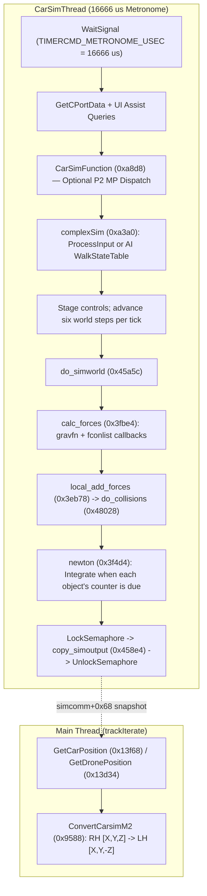

# Rigid-Body Physics, Powertrain, Aerodynamics, and `CarSimThread`

## Simulation Threading and Timing Architecture (`CarModel.c`)

Vehicle physics runs asynchronously from the 3D rendering loop inside a dedicated thread (`CarSimThread` at `0xb054`, VA `0x10b054`), spawned by `InitSimWorld` (`0xbcb8`).



### `CarSimThread` (`0xb054`, 2,460 B) and 60 Hz Metronome

1. **Dual-CPU (`P2`) and Tweak Table Setup**:
   - Calls `P2_Init` (`0xaf70`), which opens the M2 multiprocessor device (`CreateMPIOReq`) and allocates an 8 KiB second-processor stack (`P2stack` at `.data+0x181c`).
   - Loads `data/tweek.dat` (`0xb36c`), using `fscanf` to read 50 rows of four ASCII numbers into `tweekData` at `0x001815b0` (row stride 16 bytes). These values tune physics and force-feedback parameters.
2. **Metronome Timer (`16,666 µs`)**:
   - Creates a microsecond timer request (`CreateTimerIOReq`) and issues `SendIO` (`1:142` at `0xb44c`) with `io_Command = 0x0004000c` (`TIMERCMD_METRONOME_USEC`) and `timeval = {0 s, 16666 µs}` (`li r11, 0x411a` at `0xb418`, 60.0024 Hz).
   - Blocks at the bottom of each tick on `WaitSignal` (`1:166` at `0xb7c8`).
3. **Per-Tick Execution (`CarSimFunction`, `0xa8d8`)**:
   - Polls `GetCPortData` and queries UI driving-assist flags (`UI_IsAutoBrakes`, `UI_IsTraction`, `UI_IsAntilockBrakes`, `UI_IsAutoTrans`, `UI_IsArcadeMode`).
   - Executes `CarSimFunction` (1,688 B) either directly on CPU 0 or via `DispatchMPFunc` on CPU 1 (`mp_Stack = *(0x17788c) + 0x2000`).
   - Advances the world through `do_simworld`, running six `1/360 s` world steps per nominal tick (`SimWorld+0x1c`), while `SimObject+0x19c` controls each individual object's integration period.
4. **Pose Publication (`copy_simoutput`, `0x458e4`; `ConvertCarsimM2`, `0x9588`)**:
   - Under a kernel semaphore (`LockSemaphore` / `UnlockSemaphore` at `0xb934..0xb948`), calls `copy_simoutput` -> `copy_output_data` (`0x45768`), which copies each active car's timestamp (`+0x04`), world position (`+0x08..+0x10`), 3×3 orientation matrix (`+0x14..+0x34`), and wheel poses into `simcomm+0x68` (unless the render-side consumer lock byte `record+0x68` is non-zero).
   - On the render thread, `GetCarPosition` (`0x13f68`) and `GetDronePosition` (`0x13d34`) pass the snapshot to `ConvertCarsimM2` (120 B), which converts the simulation's right-handed world coordinates `[X, Y, Z]` into the M2 renderer's left-handed coordinates `[X, Y, -Z]` and negates the third row and column of the 3×3 rotation matrix, writing the player's live world position to `0x00181E10 / 0x00181E14 / 0x00181E18`.

### Simulation Step and Body Step

The physics engine tracks four distinct timestep values across world, body, and axle layers:

| State | Source Sites | Meaning |
| --- | --- | --- |
| World count and step | `InitSimWorld` (`0xbcb8`), `init_simworld` (`0x452c8`), `do_simworld` (`0x45a5c`) | The shipped count at `0x17cdd0` is `6`; the world step is `1/(60*6)` seconds (`1/360 s`), running six times per call. |
| Object period/counter | `get_object` (`0x3ee34`), `newton` (`0x3f510`, `0x3f9bc`) | `+0x19c` is a period in parent/world steps (initialized to `1`); `+0x1a0` counts toward that period. Car constructors copy the period from their configuration block at `+0x1f8`. |
| Body integration step | `set_subtree_obj_dt` (`0x3fae0`), `newton` (`0x3f520..0x3f554`) | The object's step is the parent/world step multiplied by its period or elapsed counter. A six-step body therefore integrates with `1/60 s` on a `1/360 s` world. |
| Simple-tire cached step | `setup_simple_tire` (`0x45ce0..0x45ce4`) | Copies the initial body's `+0x1a4` to axle `+0x1ec`. In the shipped simple-car initialization this is `1/360 s`; later body integration with `1/60 s` does not rewrite the axle cache. |

`do_simworld` also gates controls and wheel updates on the body's counter (see [Timing Model](../recompilation/timing-model.md) for host metronome pacing).

## Rigid-Body Core and `fconlist` Callback Architecture (`NEWTON.c`)

`NEWTON.c` (`0x3ec44..0x3fccc`, 17 functions, 4,356 B `.text`, 244 FP instructions) implements a tree-structured rigid-body dynamics engine where all forces and torques are contributed by modular callbacks attached to each object's `fconlist`.

### `NEWTON.c` Function Inventory

| Function | `.text` Offset | Size | FP Ops | Description |
|---|---:|---:|---:|---|
| `add_fconlist` | `0x3ec44` | 276 B | 0 | Allocates 64-byte `ForceNode` + optional private config blob, appends to `obj+0x1dc` |
| `get_object` | `0x3ed58` | 364 B | 2 | Allocates and initializes a `SimObject` node |
| `delete_object` | `0x3eec4` | 140 B | 0 | Frees a `SimObject` and its attached `fconlist` nodes |
| `copy_simobj_hierarchy` | `0x3ef50` | 392 B | 0 | Deep-copies a `SimObject` tree |
| `calculate_simobj_hierarchy_size` | `0x3f0d8` | 140 B | 0 | Computes byte footprint of a `SimObject` subtree |
| `duplicate_simobj_hierarchy` | `0x3f164` | 376 B | 0 | Clones a `SimObject` hierarchy into a contiguous buffer |
| `init_newton` | `0x3f2dc` | 116 B | 4 | Initializes default gravity and integrator state |
| `calc_derived_values` | `0x3f350` | 60 B | 8 | Computes `inv_mass = 1.0f / mass` and 3 principal inverse inertia components |
| `cleanup_tree` | `0x3f38c` | 160 B | 0 | Prunes/resets hierarchy links |
| `zero_forces` | `0x3f42c` | 168 B | 0 | Zeroes linear force (`+0x18`) and torque (`+0x84`, `+0x9c`) accumulators |
| `newton` | `0x3f4d4` | 1,332 B | 189 | Semi-implicit Euler linear/angular integrator and matrix orthonormalizer |
| `set_univ_pos_orient` | `0x3fa08` | 132 B | 3 | Composes parent-to-world orientation (`L * P`) and world position |
| `set_subtree_univ_pos_orient` | `0x3fa8c` | 84 B | 0 | Recursively updates world transforms across child/sibling links |
| `set_subtree_obj_dt` | `0x3fae0` | 148 B | 2 | Computes object `dt` (`+0x1a4`) from parent/world step and period (`+0x19c`) |
| `gravfn` | `0x3fb74` | 112 B | 15 | Transforms world gravity into body frame and adds `m * g_local` to `+0x18` |
| `calc_forces` | `0x3fbe4` | 232 B | 21 | Walks tree, calls `gravfn`, and invokes all `fconlist` callbacks |
| `do_newton` | `0x3fccc` | 124 B | 0 | Master step driver: `calc_forces` -> `local_add_forces` -> `newton` |

### `SimObject` Structure Layout

| Offset | Type | Field / Role |
|---:|---|---|
| `+0x00 .. +0x08` | `float[3]` | Linear velocity `[vx, vy, vz]` |
| `+0x18 .. +0x20` | `float[3]` | Live linear force accumulator `[Fx, Fy, Fz]` |
| `+0x24 .. +0x2c` | `float[3]` | Previous-step force snapshot (`F_prev`, copied from `+0x18` during `newton`) |
| `+0x6c .. +0x74` | `float[3]` | Angular velocity `[wx, wy, wz]` (rad/s) |
| `+0x84 .. +0x8c` | `float[3]` | Live continuous torque accumulator `[Tx, Ty, Tz]` (integrated with `dt`) |
| `+0x9c .. +0xa4` | `float[3]` | Angular impulse accumulator (added directly in `newton` *without* a `dt` factor; used by `COLLIDE.c`) |
| `+0xb4 .. +0xbc` | `float[3]` | Parent-relative position `[px, py, pz]` |
| `+0xe4 .. +0xec` | `float[3]` | Universe (world-space) position `[X, Y, Z]` |
| `+0x114 .. +0x134` | `float[3][3]` | 3×3 orientation matrix `M` |
| `+0x138` | `float` | Mass `m` |
| `+0x13c` | `float` | Inverse mass `1.0f / m` (followed by 3 principal inverse inertia components) |
| `+0x19c` | `int32_t` | Integration period in parent/world steps; car constructors read it from their configuration block |
| `+0x1a0` | `int32_t` | Counter toward that integration period |
| `+0x1a4` | `float` | Current object timestep (`1/360 s` initial/cached vs `1/60 s` for a six-step body) |
| `+0x1d0`, `+0x1d8` | `SimObject *` | Hierarchy `child` and `sibling` pointers |
| `+0x1dc` | `ForceNode *` | Head of singly-linked `fconlist` callback list |
| `+0x1fc` | `SimWorld *` | Pointer to enclosing world context (stores world gravity vector at `+0x04..+0x0c`) |

### `fconlist` Force-Generator Callbacks

`add_fconlist(SimObject *obj, int32_t blob_size)` (`0x3ec44`) allocates a 64-byte `ForceNode` (`mallocDebug(0x40, tag, 32)`), zeroes it, optionally allocates a private subsystem state/config buffer of `blob_size` bytes (`node+0x08 = blob`, `node+0x0c = blob_size`), and appends the node to `obj+0x1dc` via `node+0x3c` (`next`).

During `calc_forces` (`0x3fbe4`), the indirect call at `0x3fc94` invokes each node with signature:
```c
void force_callback(SimObject *obj /* r3 */, ForceNode *node /* r4 */);
```

Eight force callbacks are registered onto `fconlist` across the physics engine:

| Callback Function | `.text` Offset | Registered By | Private Blob Size | Subsystem Role |
|---|---:|---|---:|---|
| `arbarfn` | `0x421ac` | `CAR.c::create_car` | — | Front/rear anti-roll bar roll-stiffness force transfer |
| `tirefn` | `0x40e08` | `WHEELS.c::setup_wheels` | Per-wheel | Full 4-corner tire slip, contact patch, temperature/wear & grip |
| `wheelmountfn` | `0x41ad8` | `WHEELS.c::setup_wheels` | Per-wheel | Suspension strut travel, spring/damper forces, steering/camber kinematics |
| `stdbrakefn` | `0x416b8` | `WHEELS.c::setup_brake` | Per-wheel | Wheel brake torque & ABS slip release modulation |
| `powertrain` | `0x48d84` | `POWTRAIN.c::init_transmission` | Drivetrain | Engine torque curve, clutch, automatic/manual gearbox & differential |
| `aerofn` | `0x497f4` | `aero.c::init_aero` | `0x6C0` (1,728 B) | N-dimensional aerodynamic drag, downforce, side force & pitch moments |
| `bumperfn` | `0x3e3fc` | `CAR.c::init_bumpers` | Bumper | Track barrier / wall bumper spring-damper penalty forces |
| `simpcarfn` | `0x46af0` | `SIMPCAR.c::init_simple_car` | `0xB8C` (2,952 B) | Unified 2-axle tire + powertrain force generator for AI/simple cars |

### Semi-Implicit Euler Integration (`newton`, `0x3f4d4`)

After `calc_forces` and `local_add_forces` (`0x3eb78` -> `do_collisions` at `0x48028`) complete:
1. **Linear Update**:
   $$\mathbf{v}_{t+\Delta t} = \mathbf{v}_t + \Delta t \cdot \left(\mathbf{F}_t \cdot m^{-1}\right), \qquad \mathbf{p}_{t+\Delta t} = \mathbf{p}_t + \Delta t \cdot \mathbf{v}_{t+\Delta t}$$
   Copies live force `+0x18` into `+0x24`, clears `+0x18`, and updates parent-relative position `+0xb4`.
2. **Angular Update**:
   - Integrates continuous torque `+0x84` scaled by $\Delta t \cdot \mathbf{I}^{-1}$, then adds the transformed collision angular impulse (`+0x9c..+0xa4`) **directly without an extra $\Delta t$ factor**.
   - Updates the 3×3 orientation matrix `+0x114` via `xyzrot`, `mulmat`, and `makeperp` (`DISPMATH.c` Gram-Schmidt orthonormalization).
   - Propagates world-space transforms (`+0xe4` position and `+0x114` orientation) down the hierarchy via `set_univ_pos_orient`.

## Player Input, Controls, and Damage (`CarModel.c`, `CONTROLS.c`)

### Input Translation (`ProcessInput`, `0x9680`; `do_controls`, `0x46dc0`)

In `complexSim` (`0xa3a0`), the game checks `*(u32 *)(GDP + 0x70)` at `0xa5b8`:
- If `0` (human driver), it calls `ProcessInput` (1,272 B) to build the 96-byte control command packet at `0x0017C7C4` (`simInputData + 0x18`).
- If non-zero (AI attract mode or `M2_PLAYER_AI=1`), it drives the player car through the AI state machine (`WalkStateTable` + `StuffDataIn`). Opponent control packets reside at `0x0017C824 + k * 0x60`.

`ProcessInput` supports three hardware input protocols based on device mode byte `view+0x29`:
- **Mode 7 (Analog Joystick Pod)**: Reads throttle/brake axis byte `view+0x2b`, normalizes `v = byte * c10 - 1.0f`, and splits by sign (`v > eps` -> brake `[out+0x10] = v`; otherwise throttle `[out+0x0c] = -v`). Steering is read from `view+0x2a` via `adjustSteering` (`0x9600`) into `[out+0x08]`. Up stick travel is negative `v`, so pushing up gives throttle.
- **Mode 3 / 4 (4-Bit Nibble Protocol at `0x98bc..0x990c`)**: Splits `view+0x2b` into high-nibble brake (`high / 15.0f`, `[out+0x10]`) and low-nibble throttle (`low / 15.0f`, `[out+0x0c]`); a nonzero brake nibble clears the throttle channel.
- **Mode 0 (Standard 3DO Digital Control Pad)**: Reads translated word 0 and tests its `0x1000` (left) and `0x2000` (right) bits as held steering directions. While a direction is held, `out+0x08` (left-positive) integrates toward a speed-scaled limit at `0.05`/frame below 30% of the limit and `0.02`/frame above it; the limit is the squared `adjustSteering` speed factor. Release decays the command toward center at `0.1`/frame. The same block also reads bit `0x400` (A) as throttle `[out+0x0c]` and bit `0x800` (B) as brake `[out+0x10]`. Custom mode uses this path for its key/button/hat steering bindings; its analog command takes over while the stick is deflected, and the ramp resumes when it centers.

`sim_cmd_go` (`0x490b8`) stages the 96-byte packet into the simulator (`state = 3`), where the command copy at `0x45604` maps packet fields to `car+0x12d4` (steering), `car+0x12d8` (throttle), and `car+0x12dc` (brake). `do_controls` (`0x46dc0`) applies a 4-segment piecewise-linear steering sensitivity curve (`cfg+0x9c`, indexed by `clamp((int)(|steer_cmd| * 4.0f), 0, 3)`) before passing the angle to `calc_steering` (`0x46d30`); `engine_torque` (`0x48560`) consumes `car+0x12d8` and `simple_powertrain_brakes` (`0x468a4`) consumes `car+0x12dc`.

### Vehicle Templates and Damage (`InitCar`, `0xbf28`; `DamageCar`, `0x9c08`)

`InitCar` initializes each vehicle from one of four native `0x1a8`-byte car templates in `carsimmodels` (`.data+0x5d78`):
1. **Ferrari 333 SP** (`.data+0x3a58`)
2. **Danka / Riley & Scott Mk III** (`.data+0x2f58`)
3. **Kudzu DG-3** (`.data+0x43b0`)
4. **Courage C41** (`.data+0x2360`)

When `UI_IsDamageOn` is enabled, `DamageCar` (244 B, 46 FP ops) degrades aerodynamic, suspension, and engine parameters in response to collision impulses.

## Simplified / Opponent Car Model (`SIMPCAR.c`)

While the player car runs the full 4-corner multi-body simulation (`CAR.c::create_car` + `WHEELS.c`), AI opponents (and simplified simulation paths) use `SIMPCAR.c` (`0x45ca8..0x46af0`, 9 functions, 3,896 B `.text`, 402 FP ops).

| Function | `.text` Offset | Size | FP Ops | Role |
|---|---:|---:|---:|---|
| `setup_simple_tire` | `0x45ca8` | 632 B | 60 | Collapses left/right suspension corners into a single front (`0`) or rear (`1`) axle |
| `init_simple_car` | `0x45f20` | 204 B | 4 | Allocates `0xB8C`-byte (2,952 B) `SimpleCarConfig` blob via `add_fconlist`, sets `simpcarfn` |
| `init_simple_tires_surface` | `0x45fec` | 248 B | 12 | Initializes ground-contact trackers for the 2 axles |
| `create_simple_car` | `0x460e4` | 660 B | 30 | Top-level constructor for a simplified/AI vehicle |
| `do_simple_tire_surface` | `0x46378` | 292 B | 27 | Queries `find_quad` for front and rear axles and updates surface normals |
| `simple_tire_model` | `0x4649c` | 296 B | 48 | Computes axle vertical spring/damper load and friction-circle grip limits |
| `do_simple_tire_force` | `0x465c4` | 736 B | 132 | Projects steered axle forces and accumulates `arm x force` chassis torque |
| `simple_powertrain_brakes` | `0x468a4` | 588 B | 89 | Couples `POWTRAIN.c` (`engine_torque`, `shift_gears`) and brakes to the 2-axle model |
| `simpcarfn` | `0x46af0` | 240 B | 0 | Master `fconlist` callback orchestrating surface, tire, and powertrain steps |

### Two-Axle Collapse (`setup_simple_tire`, `0x45ca8`)

`init_simple_car` calls `add_fconlist(*simobj, 0xB8C)` (storing the 2,952-byte blob pointer at `container+0x133c`) and invokes `setup_simple_tire(blob, 0)` (front axle, combining corners `0` and `1`) and `setup_simple_tire(blob, 1)` (rear axle, combining corners `3` and `2`):
- Copies the body's initial timestep into `tire+0x1ec` (`1/360 s` in the shipped simple-car setup).
- Sums the left and right spring and damping rates for the axle and computes the static-load lever arm.
- Computes critical lateral yaw damping from the chassis yaw inertia $I_{zz}$, axle cornering stiffness $C_\alpha$, and longitudinal axle lever arm $|z_{\text{axle}}|$:
  $$D_{\text{lat}} = -\sqrt{\frac{4 \cdot I_{zz} \cdot (-C_\alpha)}{|z_{\text{axle}}|}}$$
- When `simpcarfn` runs, `do_simple_tire_force` gates ground penetration to `[-10.0, 0.0]`, projects the front axle along the steering basis $(\cos\delta, 0, \sin\delta)$, clamps combined longitudinal and lateral forces to the tire friction limit, and applies $\mathbf{r}_{\text{axle}} \times \mathbf{F}$ to the body torque accumulator.

## Powertrain and Gearbox (`POWTRAIN.c`)

`POWTRAIN.c` (`0x4813c..0x48d84`, 11 functions, 3,688 B `.text`, 413 FP ops) models the internal combustion engine, starter motor, clutch, manual/automatic transmission, and differential.

| Function | `.text` Offset | Size | FP Ops | Role |
|---|---:|---:|---:|---|
| `solve_mp_resist_rpm` | `0x4813c` | 76 B | 12 | Solves closed-throttle / engine-braking resistance torque vs. RPM |
| `calc_flow` | `0x48188` | 52 B | 9 | Computes atmospheric intake air mass flow correction |
| `full_throttle_torque` | `0x481bc` | 164 B | 21 | Evaluates wide-open-throttle (WOT) torque curve at current RPM |
| `solve_mp_torque_rpm` | `0x48260` | 132 B | 22 | Interpolates partial-throttle torque between WOT and motoring resistance |
| `init_engtyp` | `0x482e4` | 636 B | 77 | Initializes engine torque table and barometric/temperature scaling |
| `engine_torque` | `0x48560` | 416 B | 63 | Computes net crankshaft torque from throttle, RPM, and rev limiter |
| `starter_motor` | `0x48700` | 96 B | 12 | Cranks engine up to idle RPM threshold |
| `init_transmission` | `0x48760` | 548 B | 35 | Initializes gear ratios, shift RPM thresholds, and registers `powertrain` on `fconlist` |
| `shift_gears` | `0x48984` | 288 B | 23 | Handles manual paddle shifts and automatic upshift/downshift hysteresis |
| `transmission` | `0x48aa4` | 736 B | 95 | Computes clutch slip, gear ratio multiplication, and drive-axle torque split |
| `powertrain` | `0x48d84` | 544 B | 44 | Registered `fconlist` callback: `starter_motor` -> `engine_torque` -> `transmission` |

### Key Physical Constants and Equations

- **Angular Velocity to RPM Conversion**: Internal shaft speed $\omega$ is tracked in rad/s and converted to/from revolutions per minute via the literal `9.54928` ($\frac{60}{2\pi} \approx 9.5492966$):
  $$\text{RPM} = 9.54928 \cdot \omega_{\text{eng}}$$
- **Atmospheric Density Correction (`init_engtyp`, `calc_flow`)**: Scales engine airflow and torque output by ambient barometric pressure (in inches of mercury, populated by `surfaceHeadwind` at `0xa238`) relative to standard sea-level pressure using literals `29.9213` ($\text{inHg} = 1013.25\text{ hPa}$) and `0.03342` ($1 / 29.9213$).

## Aerodynamics (`aero.c` / `8AERO.c`)

`aero.c` (`0x491f4..0x4998c`, 8 functions, 2,184 B `.text`, 207 FP ops) implements an N-dimensional tensor-product table interpolator that computes 3 aerodynamic forces (drag, side force, downforce) and 3 aerodynamic moments (pitch, roll, yaw) as functions of ride height, pitch/yaw attitude, and wing configuration.

| Function | `.text` Offset | Size | FP Ops | Role |
|---|---:|---:|---:|---|
| `find_param_entry` | `0x491f4` | 140 B | 3 | Resolves parameter pointers (ride heights, angles) for each table dimension |
| `find_ranges` | `0x49280` | 216 B | 12 | Precomputes axis breakpoint spans during initialization |
| `find_fractional_values` | `0x49358` | 116 B | 12 | Computes normalized interpolation fractions $t_d \in [0, 1]$ per dimension |
| `setup_bounds` | `0x493cc` | 192 B | 10 | Locates bounding table indices along each parameter axis |
| `reduce_dimension` | `0x4948c` | 192 B | 26 | Recursively collapses one dimension of the $2^N$ corner hypercube via linear interpolation |
| `find_aero_data` | `0x4954c` | 680 B | 72 | Evaluates relative airspeed, runs N-D interpolation, and scales by dynamic pressure |
| `aerofn` | `0x497f4` | 408 B | 64 | Registered `fconlist` callback; accumulates aero forces (`+0x18`) and moments (`+0x84`) |
| `init_aero` | `0x4998c` | 240 B | 8 | Allocates `0x6C0`-byte (1,728 B) aero blob via `add_fconlist` and registers `aerofn` |

### Aero Blob Layout (`0x6C0` = 1,728 Bytes at `wrapper+0x1214`)

| Offset | Field / Role |
|---:|---|
| `+0x04` | Number of lookup dimensions $N$ |
| `+0x28` | Current parameter values array |
| `+0x3c` | Constructor aerodynamic scale factor |
| `+0x40` | Table record stride (`0x2c` = 44 bytes per record) |
| `+0x54 / +0x58` | Lower/upper axis index bounds |
| `+0x7c` | Fractional coordinates per axis |
| `+0xfc` | Staged corner records for recursive `reduce_dimension` reduction |
| `+0x680 .. +0x694` | **6 interpolated raw aerodynamic coefficients** ($C_x, C_y, C_z, C_{mx}, C_{my}, C_{mz}$) |
| `+0x698 .. +0x6ac` | **6 dynamic-pressure-scaled outputs** (3 forces in `[0..2]`, 3 moments in `[3..5]`) |
| `+0x6b0 .. +0x6b8` | Relative airflow velocity vector $\mathbf{V}_{\text{rel}}$ in body coordinates |

### Dynamic Pressure and Rankine Temperature Scaling (`find_aero_data`, `0x4954c`)

1. Transforms the parent airflow/wind velocity vector (`wrapper+0x1314`, updated by `surfaceHeadwind`) into the car body frame (`blob+0x6b0`) and computes squared relative airspeed $|\mathbf{V}_{\text{rel}}|^2$.
2. Computes air density and dynamic pressure scaling using imperial thermodynamic literals:
   - **`519.0`**: Standard sea-level temperature in degrees Rankine ($59^\circ\text{F} + 459.67 \approx 519^\circ\text{R}$).
   - **`460.0`**: Fahrenheit-to-Rankine conversion offset ($T_{^\circ\text{R}} = T_{^\circ\text{F}} + 460.0$, reading ambient temperature from `wrapper+0x130c` and barometric pressure from `wrapper+0x1310`).
   - **`21,170,000.0`**: Combined imperial dynamic-pressure normalization constant.
3. `aerofn` adds the 3 scaled forces (`blob+0x698..0x6a0`) into `SimObject+0x18..0x20` and the 3 scaled aerodynamic moments (`blob+0x6a4..0x6ac`) into `SimObject+0x84..0x8c`.
