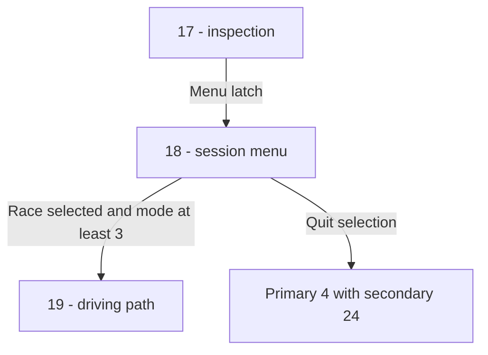
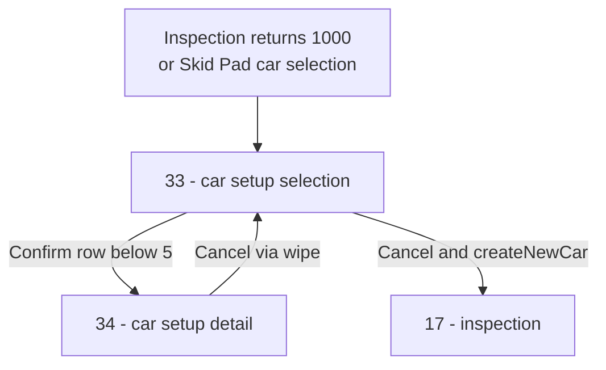

# Race Lifecycle, Checkpoints, Ranking, and Post-Race Scoring

## Race Session Lifecycle and `racePhase` (`0x2f1d4`)

After [Track Initialization](state-machine.md#track-initialization-trackinit_1-0x166dc-trackinit_2-0x1726c) completes in Primary State 2, `StateDriver` (`0x2fa4c`) transitions to Primary State 3 (`0x131138`), where `racePhase` (`0x2f1d4`, 1,444 B in `state.c`) manages the active session through the secondary state word at `.bss+0x653c` (`0x1877dc`):



The Skid Pad setup branch uses the same transition-wipe machinery as menus:



### Dispatcher and State Writes

| Secondary State | Handler and Observed Behavior |
| --- | --- |
| `17` | `0x2f244`: calls `ViewTrack(2)`. Return `1000` writes state `33` (`0x2f264`) and latches `0x1778a8 = 1`. Otherwise viewer mode `GDP+0x5c == 1` returns without opening the overlay. When not in viewer mode, a nonzero latch writes `18` (`0x2f2ac`) and calls `sndKillSnds` (`0x2baec`). Negative returns are logged and propagated. |
| `18` | `0x2f490`: configures overlay mask word `0x17d908` to `15` on Skid Pad or `7` elsewhere. Cursor byte is `0x17d8ef`. Confirm (`view+0x1c & 0x10`) selects `17` for cursor 0, `19` for cursor 1 only when `GDP+0x63 >= 3`, `33` for cursor 2 on Skid Pad, or primary `4` / secondary `24` for cursor 2 elsewhere and cursor 3. Cancel (`& 0x20`) writes `17`. With the caller's draw flag nonzero, calls `ViewTrack(2)` at `0x2f654` and renders the overlay. |
| `19`, `20` | Entries `0x2f694`, `0x2f6c0` share `0x2f6fc..0x2f700`, which passes `2` to `ViewTrack`. Their first-entry latch is byte `0x17d881`; they set `0x17da24 = 1` and clear `0x1778a8`. An event word equal to `0x40` after drawing resets the entry latch, writes `18` (`0x2f72c`), stops race sounds, and relatches the overlay. |
| `33` | `0x2f2d4`: car configuration descriptor `0x17da00`. Confirm with cursor `< 5` requests state `34` through the transition callbacks (`0x2f310..0x2f35c`); cancel writes `17` and calls `createNewCar` (`0x1a718`) at `0x2f388`, then helper `0x16688`, clearing the menu latch. Dirty frames draw `UI_DrawConfigCar` (`0x38d84`). |
| `34` | `0x2f3e4`: detail selection. Cancel requests state `33` through the reverse callbacks (`0x2f40c..0x2f458`); dirty frames draw `UI_DrawConfigCar_showmodel` (`0x390b0`). |

Unknown secondary values return without a handler. `ViewTrack` (`0x1a5d4`) calls `trackIterate(2, 0)` when passed `2`.

The garage event is one of the [Skid Pad trigger volumes](tracks.md#skid-pad-trigger-volumes), latching `0x1778a8` (`0x2f268`) and `0x17d8b0` (`0x2f27c`). The [master transition controller](state-machine.md#transition-state) executes the wipes requested by states `33` and `34` and restores primary phase `3`.

### Session Exit and Finish Delay

Overlay quit writes primary `4` and secondary `24` (`0x2f5d4..0x2f5dc` or `0x2f5f4..0x2f5fc`), clearing the caller's draw flag. Independently, `StateDriver` (`0x31164..0x31194`) counts down its `r16` finish delay after `GDP+0x63 == 7`, then writes the same primary/secondary pair. Negative `racePhase` returns branch to the `StateDriver` return path at `0x31158`.

When primary phase `4` has been selected, `0x311a8..0x31218` stops race sounds, tears down the track, and computes results. The next phase-4 dispatch checks secondary `24` (`0x31224..0x3122c`) before playing the outcome sequence.

## Starting Grid and the Rolling Start Mode Ladder (`GDP+0x63`)

Races use an IMSA-style rolling start. Authored `STRT` records in `<track>.memimage` (24 slots on Testona/Leary, 36 on Laguna/New Orleans/Suzuka, 12 on Skid Pad) place `racers[0]` (the player) and `numDrones` (`[0x187544]`, `.bss+0x62a4`) AI cars prior to the start/finish target checkpoint `TARG` (`tdp+0x1c`). Initial rolling speeds are seeded from `tdp+0x4c` and `tdp+0x50` (`IVEL[0]` and `IVEL[1]`, copied to `.bss+0x00` and `.bss+0x04`).

During the rolling approach to the start line, `GDP+0x70` is set to `1`, which causes `complexSim` (`0xa3a0`) to drive the player's car under AI control (`ContinueDriving` at `0x49dc`). Progression from rolling start to green flag and checkered flag is governed by the mode byte `GDP+0x63` (`GDP` at `[0x184cf4]`), which is written exclusively by 8 sites inside `ProcessCheckPoints` (`0x3258` in `ai.c`) and read by `ProcessCheckPoints`, `ContinueDriving`, and `CarSimFunction` (`0xaa90/0xabf8`):

| `GDP+0x63` Mode | Transition Condition in `ProcessCheckPoints` (`0x3258`) | Side Effects & Meaning |
|---|---|---|
| `0 -> 1` | `car+0x0c >= ladder - 8` (signed) and `mode == 0` (`0x34f4`) | Rolling pack approaches within 8 checkpoints of start/finish |
| `1 -> 2` | `car+0x0c == ladder - 5` and `mode == 1` (`0x3520`) | Pack reaches 5 checkpoints before start/finish |
| `2 -> 3` | Arm A1 (`0x33dc`): lead car crosses start line while `mode < 3` | **Green Flag:** zeroes `racers[0].elapsed_time` (`+0x3c = 0`), sets `mode = 3`, and clears `GDP+0x70 = 0` (unlocking live player steering/throttle/brake in `complexSim`) |
| `3 -> 4` | `car+0x0c == 4` (hardcoded checkpoint `4`) and `mode == 3` (`0x3548`) | Lead car clears checkpoint 4 on lap 1; arms white-flag detection |
| `4 -> 5` | Arm A2 (`0x3424`): `car+0x04 == laps - 1` and `mode == 4` | **White Flag:** prints `"White Flag.  Last Lap.\n"` (`0x1070c8`) |
| `5 -> 6` | Arm A3 (`0x345c`): `car+0x04 == laps` and `mode == 5` | **Race Won (Leader Finished):** prints `"Race Won\n"` (`0x1070e0`) |
| `-> 7` | Arm A4 (`0x3494`): `racers[0]+0x04 == laps` and `mode != 7`<br>Arm A5 (`0x34d0`): `car == &racers[0]` and `mode == 6` | **Player Finished:** sets `mode = 7`, sets `GDP+0x70 = 1` (hands player car back to AI cool-down control), prints `"Player Car Finished\n"` (`0x1070ea`) or `"Player Car Finished 2\n"` (`0x1070ff`) |

## Lap and Checkpoint Progression (`ProcessCheckPoints`, `0x3258`)

`ProcessCheckPoints` (928 B in `ai.c`) tracks each car's longitudinal progress along the track's centerline checkpoints. The per-track checkpoint count `ladder` is stored at `GDP+0x21a0` (copied from `tdp[+0x14]` = `NMPT` at `0x2541c`; see [Shipped Tracks on Disc](tracks.md#shipped-tracks-on-disc)).

### When a Lap Counts (`0x3330..0x3370`)
When a car wraps around the centerline, its completed lap counter `car+0x04` is incremented if and only if all four guards pass:
1. **Checkpoint wrap:** `car+0x08 (checkpoint_word) > ladder` (`ble` at `0x333c` blocks on `<=`).
2. **Forward delta sanity check:** `car+0x10 (numLaps / step delta) < (ladder >> 2)` (`srawi` by 2, `bge` at `0x334c` blocks if the car jumped more than a quarter-lap in one update).
3. **On-course check:** `car+0x64 (off-course / wrong-way flag) == 0` (`bne` at `0x3358` blocks).
4. **Track check:** `UI_GetTrack() != 4` (`beq` at `0x3364` blocks lap increments on Skid Pad).

## Race Standings (`RankRacers`, `0x6a20`)

`RankRacers` (804 B, 201 insns in `ai.c`) computes 1-based race standings (`1 .. numDrones + 1`) across the `racers` array (`0x184D00`, stride `0x124` = 292 bytes) without reordering the array in memory:

1. **Coarse Progress Key:** For each racer `i` in `0 .. numDrones`, computes a 32-bit integer progress key:
   ```c
   int32_t key[i] = (racers[i].laps << 12)          // +0x04 * 4096
                  + (racers[i].checkpoint << 3)     // +0x08 * 8
                  - (racers[i].off_course ? 0x1000 : 0); // +0x64 penalty = 1 full lap
   ```
2. **Sub-Checkpoint Tie-Breaking Loop:** If two racers share the exact same `key`, `RankRacers` inspects the centerline situation flags at `[racer_i[+0x58] + (racer_i[+0x08] << 5) + 0x0c]`:
   - Bit 1 (`0x02`) selects whether the track segment runs predominantly along world X (`racer+0x24`) or world Z (`racer+0x2c`).
   - Bit 0 (`0x01`) selects the sign/direction of travel along that axis.
   - The car further ahead along the selected axis has its `key` incremented by `+1`, and the tie-break scan repeats until a fixpoint with no ties is reached.
3. **Place and Dynamic AI Personality Assignment:**
   - Each racer's 1-based standing is written to `racers[i][+0x14] = 1 + #{j : key[j] > key[i]}`.
   - For AI opponents (`i = 1 .. numDrones`), updates their rubber-banding/aggression personality pointer based on current standing: `racers[i][+0x90] = personalityTable[place]`.

## Timing, Crash Recovery, and Replays

The master race clock `[0x184D3C]` is incremented inside `CarSimFunction` (`0xa938`) at 60 Hz. Player total race time (`racers[0]+0x38`), current/elapsed lap time (`+0x3c`), and best lap time (`+0x34`) are formatted for the HUD and high-score screens by `GetMinSecHund` (`%02d:%02d.%d` and `%02d:%02d.%02d`).

In `Crashing.c`, `HandlePlayerCrashing` (`0xdfa8`), `HandleDroneCrashing`, `InitRestartStuff`, `relocate_car` (`0x3e890`), and `LimitCarSpeed` (`0xde2c`) detect severe off-track excursions or stalled collisions and request relocation. No formal IMSA rulebook penalty system (stop-and-go, black flag, or pit-lane speed enforcement) is implemented in the binary.

In `replay2.c`, `repInit`, `repSaveReplay`, `repRestoreReplay`, `writeRepNode`, `readRepNode`, and `rep*Phantom*` record and play back race telemetry by serializing two `0x200`-byte circular buffer nodes, a `+0x400` state block, and 5 scalar words at `+0x600..0x610`.

## Race Completion, FMVs, and High Scores

When Primary State 3 exits (`0x311dc..0x31210` in `StateDriver`), it computes an outcome selector `r25`:
- `r25 = 2` (**DNF**) if `GDP+0x63 < 6` (race exited before completion).
- `r25 = 0` (**Win**) if `GDP+0x63 >= 6` and player standing `racers[0]+0x14 <= 1`.
- `r25 = 1` (**Lose**) if `GDP+0x63 >= 6` and `racers[0]+0x14 > 1`.

`StateDriver` passes `r25` to `hs_calcresults`, then advances to Primary State 4 (`0x31220`) to play the corresponding post-race Full Motion Video via `VideoPlayer` from the filename table at `0x17d89c..0x17d8a8` (skipped on Skid Pad or in solo practice when opponent option == `1`):
- **Win (`r25 == 0`):** Randomly picks `win1.mov` or `win2.mov` using `rand2` parity.
- **Lose (`r25 == 1`):** Plays `lose.mov`.
- **DNF (`r25 == 2`):** Plays `dnf.mov`.

### Per-Track High-Score Tables (`0x17C134`)
Each track owns a `0xC8`-byte (200-byte) high-score block at `0x17C134 + track * 0xC8`:
- **`+0x00..+0x63` (Best Lap / Race Times):** Five 20-byte records (`u32` time in 60 Hz ticks + 16-byte ASCII driver name). Checked and inserted via `hs_checknewtime` (lower tick count wins, shifting lower rows down via `memmove`).
- **`+0x64..+0xC7` (Top Average Speeds):** Five 20-byte records (`f32` average MPH + 16-byte ASCII driver name). Checked and inserted via `hs_checknewmph` (higher float MPH wins).

If either check qualifies for the top 5, `hs_getname` seeds `"DUMMYNAME"` and `StateDriver` transitions to Primary State 1 / Secondary State 32 (High-Score Name Entry) before displaying Secondary State 31 (High-Score Table View).
