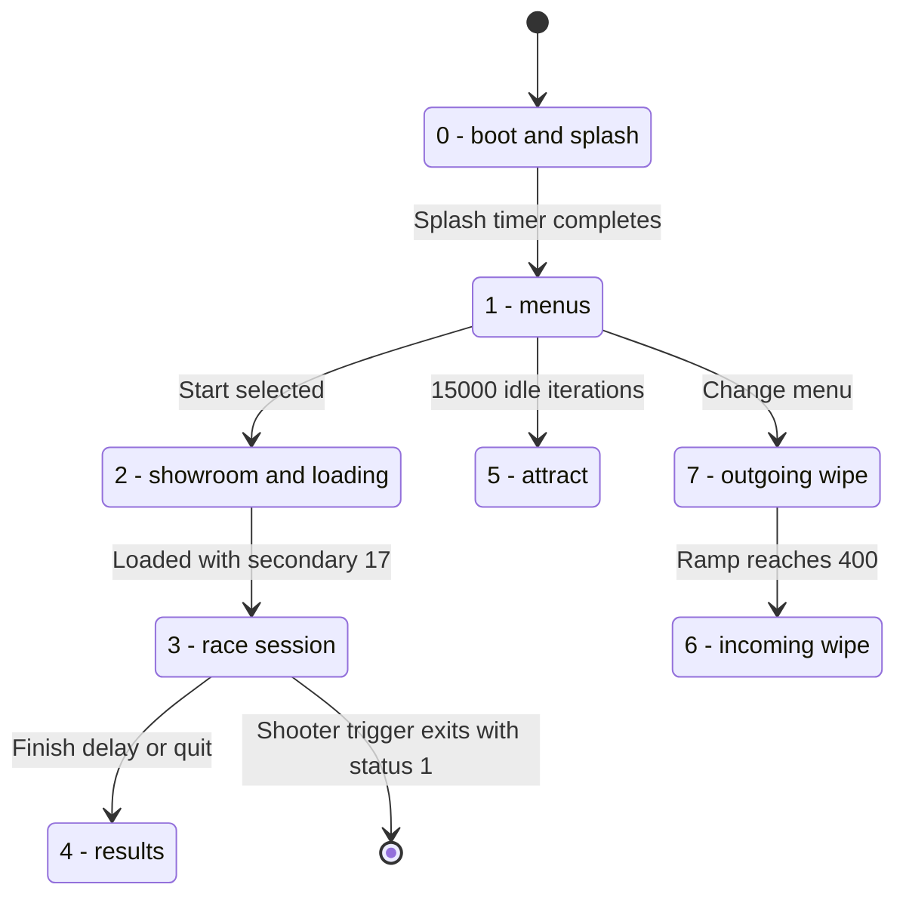

# Master State Machine and Track Frame Pipeline

## Module Inventory (`game.c`, `state.c`, `ui.c`)

The `game.c + state.c` cluster (`0x13d34..0x31d00`, 67 functions, ~60 KiB) and `ui.c` (`0x3811c..0x3b0f8`, 27 functions) implement the main state machine, HUD, and menus:

| Function | `.text` Offset (VA) | Size | Role |
|---|---|---:|---|
| `GetDronePosition` | `0x13d34` (`0x113d34`) | 564 B | Reads opponent pose from `simoutput`, calls `ConvertCarsimM2` |
| `GetCarPosition` | `0x13f68` (`0x113f68`) | 1,700 B | Reads player pose, updates `0x181E10/14/18`, computes camera/audio frame |
| `RenderMap` | `0x1470c` (`0x11470c`) | 668 B | Renders 2D track minimap and car markers |
| `DrawTach1..4` | `0x14a24..0x15000` | 4 fns | Per-car tachometer needle/bar rendering |
| `DrawDashBoard` | `0x153b8` (`0x1153b8`) | 3,284 B | Cockpit dashboard, gear indicator, lap/split timers, speedometer |
| `DrawInfoBar` | `0x1608c` (`0x11608c`) | 1,284 B | Top/bottom HUD info bar overlay |
| `RenderWheel` | `0x16590` (`0x116590`) | 248 B | Animated cockpit steering wheel |
| `trackInit_1` | `0x166dc` (`0x1166dc`) | 1,516 B | Async stage-1 track loader (pods, car models, sound init) |
| `initCarModel` | `0x16d10` (`0x116d10`) | 1,136 B | Initializes car 3D hierarchy and wheel attachments |
| `trackInit_2` | `0x1726c` (`0x11726c`) | 7,768 B | Stage-2 track loader (`%s.memimage`, `MS_Init`, `InitCar` ×3, `InitSimWorld`) |
| `trackIterate` | `0x190c4` (`0x1190c4`) | 5,392 B | Per-frame 3D race loop (input, camera, collision, Mercury render, HUD) |
| `ViewTrack` | `0x1a5d4` (`0x11a5d4`) | 80 B | Wrapper calling `trackIterate(2, 0)` for pre-race track preview |
| `createNewCar` | `0x1a718` (`0x11a718`) | 804 B | Instantiates player or opponent car state |
| `activatesecrettrack` | `0x2e578` (`0x12e578`) | 60 B | Sets `0x17D968 = 6` to unlock Track 5 ("Psychedelia" / `ra_leary`) |
| `DestBlendInit` | `0x2e870` (`0x12e870`) | 868 B | Configures destination-alpha/Z-buffer sky composite quads |
| `doButtonMenu` | `0x2ee5c` (`0x12ee5c`) | 888 B | Generic menu cursor navigation and button highlight handler |
| `racePhase` | `0x2f1d4` (`0x12f1d4`) | 1,444 B | State 3 sub-state controller (staging, countdown, race, post-race) |
| `loadPrefs` / `savePrefs` | `0x2f778` / `0x2f82c` | 180 / 224 B | Loads/saves the 56-byte `IMSAprefs` file on `/card` (see [Configuration Accessors and MicroCard Persistence](menus.md#configuration-accessors-and-microcard-persistence-imsaprefs)) |
| `AssignInputs` | `0x2f90c` (`0x12f90c`) | 320 B | Installs digital (`0x17C718`) and analog (`0x17C750`) control maps |
| `StateDriver` | `0x2fa4c` (`0x12fa4c`) | 7,372 B | Master state machine loop (1,843 instructions, 3 `bctr` jump tables) |
| `UI_GetTrack` | `0x31718` (`0x131718`) | 132 B | Returns selected track index (`0..5`) |
| `UI_DrawMain` | `0x3811c` (`0x13811c`) | 464 B | Main menu renderer (`bctr` at `0x38210`, 7-arm jump table) |
| `UI_DrawConfigRace` | `0x382ec` (`0x1382ec`) | 960 B | Race configuration screen (`bctr` at `0x38468`, 7-arm jump table) |
| `UI_DrawOptions` | `0x386ac` (`0x1386ac`) | 1,032 B | Options menu screen (`bctr` at `0x387cc`, 9-arm jump table) |
| `UI_DrawConfigCar` | `0x38d84` (`0x138d84`) | 812 B | Car setup screen (`bctr` at `0x38ea4`, 8-arm jump table) |

## `StateDriver` (`0x2fa4c`, VA `0x12fa4c`) Architecture

`StateDriver`'s three `bctr` switch dispatches span 42 jump-table entries across 25 unique target labels.

### Key State Variables in `.bss` and `.data`

| Symbol / Role | Guest Address | Section Offset | Type | Description |
|---|---|---|---|---|
| `phase` (Primary State) | `0x001877D8` | `.bss + 0x6538` | `u32` | Top-level phase (`0..7` in Dispatch A; values above 7 jump to the frame tail) |
| `state` (Secondary State) | `0x001877DC` | `.bss + 0x653c` | `u32` | UI dispatch covers `6..32`; `racePhase` separately handles `17..20` and `33..34` |
| `oldphase` | `0x001877E0` | `.bss + 0x6540` | `u32` | Saved primary state for push/pop transitions |
| `oldstate` | `0x001877E4` | `.bss + 0x6544` | `u32` | Saved secondary state for push/pop transitions |
| `cursor_byte` (Byte State) | `0x0017D94B` | `.data + 0x78db` | `s8` | Menu cursor / action selector (`0..6` in Dispatch C) |
| `ui_dirty` | `0x0017D8B8` | `.data + 0x7848` | `u32` | Screen dirty flag cleared at loop tail |
| `sig_pending` | `0x00188C80` | `.bss + 0x79e0` | `u32` | Signal mask waited on at `0x3110c` during async track loading |

### Dispatch A: Primary State (`bctr` at `0x2fbe8`, Pool `0x2fbec..0x2fc08`)

At the top of each frame (`L2fb88`), `StateDriver` polls controller input via `GetCPortData` (`0xf9a8`) and `Ctrl_TranslateInput` (`0xfc64`), loads `r31 = *(u32 *)0x1877d8` (`phase`), and checks `cmplwi r31, 7; bgt 0x31424`.

| `phase` | Target VA | Summary of Operations |
|---:|---|---|
| **0** | `0x12fd50` | **Boot & Title Splash**: Calls `TwoD_Init`, `mem_define_zone`, `sndInitUISound`, `ConnectEventBroker`, `RegisterDevices`, `AssignInputs`, `loadPrefs`, `UI_LoadArt`, `TwoD_LoadBitmap`, `TwoD_DrawBitmap`, `sndStartMusic`. Plays `intro.mov` through `VideoPlayer` and runs a 300-frame timer (`0x30058..0x30178`), then sets `phase = 1` (`0x3014c`) and `state = 27` (`0x30174`). (If `-T` was passed on the command line, jumps directly into track loading.) |
| **1** | `0x13017c` | **2D Menu Hub**: Chains immediately into Dispatch B (`0x301b8`) to service the active menu screen (`state` `27..32`). |
| **2** | `0x130ea0` | **3D Showroom & Track/Car Selection**: Unloads 2D menu art (`UI_UnloadArt`), runs `showRoomInit`, `showRoomIterate`, `SR_ShowMerc`, and `showRoomTearDown` (`state == 25` for Car Selection, `state == 26` for Track Selection). Spawns async loader thread (`startuptrackinitthread_1` -> `trackInit_1`) and waits on `sig_pending` at `0x3110c` before advancing to `phase = 3, state = 17`. |
| **3** | `0x131138` | **Active Race Execution**: Invokes `racePhase` (`0x2f1d4`). On race exit, calls `sndKillSnds`, `doTrackTearDown`, and `hs_calcresults`, transitioning to `phase = 4` (or `phase = 1`). |
| **4** | `0x131220` | **Post-Race Results & FMV**: Queries `UI_GetTrack` and `UI_GetOpponent`, plays post-race full-motion video clips via `VideoPlayer` (up to 5 call sites), and displays `UI_DrawHighScores_postRace`. |
| **5** | `0x12fce0` | **Screensaver / Attract Mode**: Runs `iteratescreensaver` and restores the saved screen on its return condition. The common tail enters attract mode after 15,000 idle iterations (`0x315a0`). |
| **6** | `0x12fc58` | **Incoming Transition**: Calls the incoming transition callback (`0x2fc58..0x2fcd8`) while decreasing the ramp by 20 to zero; then installs the pending secondary state and restores the saved primary phase. |
| **7** | `0x12fc0c` | **Outgoing Transition**: Calls the outgoing transition callback (`0x2fc0c..0x2fc54`) with a ramp increasing by 20 to 400, then selects phase 6. |
| **> 7** | `0x131424` | **Out-of-Range Guard**: Jumps directly to the common frame tail. |

### Dispatch B: Secondary State (`bctr` at `0x301b8`, Pool `0x301bc..0x30224`)

Reached from Primary Arm 1 (`0x13017c`). Reads `r11 = *(u32 *)0x1877dc` (`state`), computes `r0 = r11 - 6`, and checks `cmplwi r0, 0x1a; bgt 0x31424` (27-word table covering `state = 6..32`, with 10 distinct target addresses; 18 default entries point to the default tail `0x131424`):

| `state` | Hex | Target VA | Role |
|---:|---|---:|---|
| **6..15, 17..24** | `0x06..0x17` | `0x131424` | Default arm (jumps to common loop tail; `racePhase` handles `17..20` and `33..34` under primary phase 3; state `24` is consumed under phase 4) |
| **16** | `0x10` | `0x130d24` | Load/save preferences prompt (`loadPrefs` / `savePrefs`) |
| **25** | `0x19` | `0x130de4` | Showroom car selection transition |
| **26** | `0x1a` | `0x130b04` | Track selection screen (`UI_DrawTrackSelect` / MPEG still background) |
| **27** | `0x1b` | `0x130228` | **Main Menu** (`UI_DrawMain`, `doButtonMenu`, chains into Dispatch C at `0x3031c`) |
| **28** | `0x1c` | `0x1305b4` | **Configure Race** (`UI_DrawConfigRace`: laps, opponent, transmission, arcade/sim mode) |
| **29** | `0x1d` | `0x1306c4` | **Configure Car** (`UI_DrawConfigCar`: body, engine, tires, gears, wing angle) |
| **30** | `0x1e` | `0x130758` | **Game Options** (`UI_DrawOptions`: audio volume, fog, control config) |
| **31** | `0x1f` | `0x1307d4` | **High Scores (from UI)** (`UI_DrawHighScores_fromUI`) |
| **32** | `0x20` | `0x130c58` | **High Scores Name Entry** (`UI_DrawHighScores_nameEntry`) |

### Dispatch C: Main Menu Action Byte (`bctr` at `0x3031c`, Pool `0x30320..0x30338`)

Reached inside Secondary State 27 (`0x130228`) when the player confirms a main-menu selection. Reads signed byte `r11 = *(s8 *)0x17d94b` (`.data+0x78db`), applies two conditional self-clamps (`if (byte == 6 && r31 == 0) byte = 4` at `0x30290..0x302a8`; `if (byte == 5 && r3 == 0) byte = 4` at `0x302b8..0x302c0`), and dispatches across 7 arms (`0..6`):

| `cursor_byte` | Target VA | Transition |
|---:|---|---|
| **0** | `0x13033c` | **Start Race / Showroom**: Sets `phase = 2` (`0x3036c`) and `state = 25` (`0x30394`) |
| **1** | `0x1303b8` | **Configure Race**: Pushes transition (`phase = 7`), enters `state = 28` |
| **2** | `0x13042c` | **Configure Car**: Pushes transition (`phase = 7`), enters `state = 29` |
| **3** | `0x13049c` | **Options**: Pushes transition (`phase = 7`), enters `state = 30` |
| **4** | `0x1304c8` | **High Scores**: Pushes transition (`phase = 7`), enters `state = 31` |
| **5** | `0x130560` | **Replay / Demo**: Starts replay/demo flow |
| **6** | `0x130568` | **Quit / Exit**: Exits `StateDriver` loop |

### Common Frame Tail (`L31424` at `0x31424`)

At the end of every iteration, `StateDriver` converges on `0x31424`:
1. Performs UI audio housekeeping (`6:67 StopInstrument`, `6:69 StartInstrument`).
2. Clears the UI dirty flag at `0x17d8b8` (`.data+0x7848`).
3. Handles the idle/attract gate, optional screenshot, and display/UI presentation (`GS_WaitIO` at `0x31648` and `Dsply_SwapBuffers[_trans]` at `0x31680` / `0x31698`).
4. Reinitializes TE state with `TEInit` (`0x4b29c` at `0x316d8`), then branches back to `0x2fb88` (`0x316dc`).

### Transition State

The transition control words live at `.bss+0x6550` / `+0x6554` (outgoing and incoming callbacks), `+0x6558` (ramp), and `+0x655c` (pending secondary state). Phases `7` and `6` step the wipe ramp by `20` per iteration up to `400` and back to `0`, while `oldphase` and `oldstate` hold the saved state. The guest also uses `dotrans` wipe effects with 16-, 30-, or 48-frame spans.

`dotrans` types `15` and `16` select `dorotatetrans` (`0x33880`, opposite directions), while type `2` draws a hardware-random effect index (`mod 14`). `dorotatetrans` is a 30-frame effect that reloads the live display through 36 MMDMA strips per frame (`576×12` RGB555+SSB rows). The host caches the shared display sheet once per frame and copies each strip from that cached readback so the wipe runs at its authored 30-frame cadence.

## Active Race Loop: `racePhase` (`0x2f1d4`) and `trackIterate` (`0x190c4`)

When `phase == 3`, `StateDriver` calls `racePhase` (`0x2f1d4`, 1,444 B) every frame.

### Track Initialization (`trackInit_1`, `0x166dc`; `trackInit_2`, `0x1726c`)

Before entering `racePhase`, the two-stage track loader builds the 3D scene and physics world:
1. Loads `%s.memimage` (track geometry pods), `carssp.memimage`, `engine.%d.memimage`, and `_phantom.dat` (the disc's phantom lap).
2. Initializes the Mercury renderer (`MS_Init`), registers 12 LOD pod groups (`MS_UpdateLoadedPodLodGroup`), builds 3 car models (`MS_buildcar`), and constructs visibility portals (`MS_BuildAreas`).
3. Initializes environmental effects (`EF_InitEFObjects`), planar car shadows (`carshadow_initshadows`), headlights (`headlights_newheadlight` ×2), trackside cones (`Col_MakeCones`), skidmark buffers (`initskids`), and car collision hulls (`Col_AddCar`).
4. Loads AI personalities (`LoadPersonalities`), initializes joystick/force-feedback state (`InitJoyStick`), starts game audio (`sndInitGameSnd`), initializes 3 vehicle physics instances (`InitCar` ×3), spawns `CarSimThread` via `InitSimWorld` (`0xbcb8`), and initializes the camera system (`Cam_InitModule`).

### Race-Session Boundary

`racePhase` handles secondary states `17`, `18`, `19`, `20`, `33`, and `34` (inspection, overlay, driving, and car setup), while race countdown and finish modes follow the `GDP+0x63` ladder in [Starting Grid and the Rolling Start Mode Ladder](race-rules.md#starting-grid-and-the-rolling-start-mode-ladder-gdp0x63).

### `trackIterate` (`0x190c4`, 5,392 B) Per-Frame Pipeline

Each frame during `trackIterate`:
1. **Input and Replay**: Polls `GetCPortData` + `Ctrl_TranslateInput` and updates `ReplayOn` state.
2. **Pose Acquisition and Camera**: Calls `GetCarPosition` (`0x13f68`) and `GetDronePosition` (`0x13d34`) to snapshot physics poses from `simoutput` (converting right-handed physics coordinates to left-handed M2 render coordinates via `ConvertCarsimM2` at `0x9588`), then updates the active camera (`Cam_TweenTo`, `Cam_Update`, `Cam_FlyUpdate`).
3. **Prop Collision and Particle Effects**: Calls `Col_TestCollisions` (`0xf1bc`) for trackside cones/props and `EF_MakeSmoke` for tire smoke particles.
4. **3D World and Sky Rendering**:
   - Binds the active color framebuffer (`0x476000` or `0x4f0000`, stride 576) via `GS_SetDestBuffer` (`0x19b30`) and clears depth/color via `CLT_ClearFrameBuffer` (`0x19b80`).
   - Renders the 3D track and cars via `MS_ShowWorld` and `GS_SendLastList`.
   - **Sky compositing**: Temporarily binds the 16-bit Z-buffer (`0x56a000`, Item `0x3028`) as a *color destination* to rasterize 4 untextured cyan (`0x201d0003`) fullscreen quads, then rebinds the color framebuffer (`0x4f0000`/`0x476000`) and draws 4 destination-blended composite quads (`576×432`, `DBZCNTL = 0x1` strict `PixelLt` against background clear depth `0xFFF8`) initialized by `DestBlendInit` (`0x2e870`) so the 2D sky/horizon backdrop (`TwoD_DrawBitmap` at `0x19be4`) only fills untouched background pixels.
5. **Mirrors, Radar, and Cockpit HUD**:
   - Renders the rear-view mirror (`RenderMirrorFrame`, `CLT_SetSrcToCurrentDest`) and proximity radar (`MS_Radar_Set`, `RenderRadarFrame`).
   - Draws depth-disabled (`DBUSERCONTROL = 0`) HUD elements: `DrawDashBoard` (×2), `RenderWheel`, `DrawInfoBar`, `DrawTach1..4`, and `RenderMap`.
6. **Audio Updates**: Updates announcer voiceovers (`sndDoVoiceOver`) and Doppler-shifted opponent engine audio (`sfxStartOppSnd`).
7. **Skid Pad Events (`0x1a454..0x1a5c0`)**: Tests three trigger volumes on track 4 (see [Skid Pad Trigger Volumes](tracks.md#skid-pad-trigger-volumes)).
