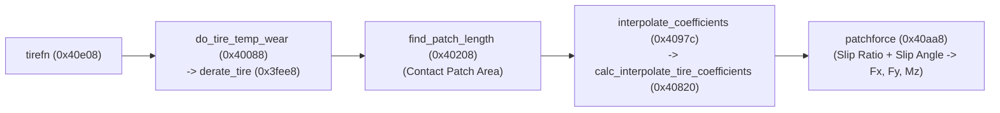

# Tires, 4-Corner Suspension, Brakes, and Ackermann Steering

## `WHEELS.c` Module Overview

`WHEELS.c` (`0x3fd84..0x421ac`, 16 functions, 9,728 bytes of `.text`, 1,426 floating-point instructions) implements the tire and suspension model in `driving/game`. It models four independent sprung/unsprung wheel corners (`i = 0..3`: Front-Left, Front-Right, Rear-Right, Rear-Left) for the player's car.

| Function | `.text` Offset (VA) | Size | FP Ops | Role |
|---|---|---:|---:|---|
| `setup_brake` | `0x3fd84` (`0x13fd84`) | 356 B | 33 | Registers `stdbrakefn` on `fconlist` and initializes per-wheel brake parameters |
| `derate_tire` | `0x3fee8` (`0x13fee8`) | 416 B | 69 | Computes grip multiplier from tire temperature and cumulative wear |
| `do_tire_temp_wear` | `0x40088` (`0x140088`) | 384 B | 55 | Integrates frictional heating, convective cooling, and tread wear |
| `find_patch_length` | `0x40208` (`0x140208`) | 268 B | 29 | Computes tire deflection and contact-patch length/area from vertical load |
| `calc_tire_coeffs` | `0x40314` (`0x140314`) | 256 B | 34 | Precomputes baseline tire stiffness and damping scalars at setup |
| `setup_tire` | `0x40414` (`0x140414`) | 348 B | 23 | Initializes a corner's 8-record tire table and state blob |
| `setup_wheels` | `0x40570` (`0x140570`) | 688 B | 82 | Master 4-corner constructor: converts suspension frequencies, registers callbacks |
| `calc_interpolate_tire_coefficients` | `0x40820` (`0x140820`) | 348 B | 65 | Linearly interpolates the 5 tire coefficients + 3 derived damping terms |
| `interpolate_coefficients` | `0x4097c` (`0x14097c`) | 300 B | 10 | Brackets normal force across the tire table (`0x2c` stride, up to 8 slots) |
| `patchforce` | `0x40aa8` (`0x140aa8`) | 864 B | 135 | Computes combined contact-patch forces from sliding, travel, and rotational contact velocities |
| `tirefn` | `0x40e08` (`0x140e08`) | 2,224 B | 376 | Per-wheel `fconlist` callback: ground contact, temp/wear, `patchforce`, wheel spin |
| `stdbrakefn` | `0x416b8` (`0x1416b8`) | 420 B | 67 | Per-wheel `fconlist` brake callback with ABS slip release modulation |
| `init_tires_surface` | `0x4185c` (`0x14185c`) | 256 B | 12 | Initializes 4 `ContactState` trackers (`CATMULL.c::init_contacttyp`) |
| `do_tires_surface` | `0x4195c` (`0x14195c`) | 380 B | 38 | Resolves track quad under each wheel (`find_quad`) and averages surface normal |
| `wheelmountfn` | `0x41ad8` (`0x141ad8`) | 1,748 B | 305 | Suspension strut kinematics, spring/damper forces, camber/toe/steering transforms |
| `arbarfn` | `0x421ac` (`0x1421ac`) | 472 B | 93 | Front and rear anti-roll bar force transfer between left and right corners |

## Four-Corner Setup and Suspension Frequency Conversion (`setup_wheels`, `0x40570`)

`setup_wheels` reads the vehicle configuration block pointer from `simobj+0x428` (installed by `sim_cmd_init` at `0x4904c` from `racer+0x1b4`). The four corner specification pointers sit at `block + 0x58 + i * 4` (`i = 0..3`).

### Literal Pool Constants (`.text + 0x42384..0x42390`)

| Offset | Value | Physical Meaning |
|---:|---:|---|
| `0x42384` | `1.0f` | Unity numerator |
| `0x42388` | `-39.4786f` | $-4\pi^2 \approx -39.4784176$, converts suspension natural frequency $f_{\text{hz}}$ (in Hz) to squared angular frequency $-\omega_n^2 = -(2\pi f_{\text{hz}})^2$ |
| `0x4238c` | `-4.0f` | Critical damping radicand multiplier ($-4 k m$) |
| `0x42390` | `0.0f` | Zero clamp |
| `0x42394` | `0.5f` | Half-track / midpoint scale |

For each corner:
1. Converts the configured ride-frequency / stiffness parameters using `-39.4786f` ($-4\pi^2$) and normalizes by the tire radius (`wheel+0x1a4`):
   $$f_{30} = \left(\frac{K}{R_{\text{tire}}}\right)^2$$
2. Calls `setup_tire` (`0x40414`) and `calc_tire_coeffs` (`0x40314`).
3. Registers per-wheel `fconlist` callbacks on the wheel/chassis hierarchy:
   - `tirefn` (`0x40e08`)
   - `wheelmountfn` (`0x41ad8`)
   - `stdbrakefn` (`0x416b8`, registered via `setup_brake` at `0x3fd84`)
   - `arbarfn` (`0x421ac`, registered on the car body by `CAR.c::create_car`)

## Suspension Kinematics (`wheelmountfn`, `0x41ad8`) and Anti-Roll Bars (`arbarfn`, `0x421ac`)

### `wheelmountfn` (`0x41ad8`, 1,748 B, 305 FP Ops)

Each substep, `wheelmountfn` couples the unsprung wheel/hub state to the sprung chassis `SimObject`:
1. **Frame Transformations**: Uses `DISPMATH.c` helpers (`transpmulmat`, `wxrot`, `wyrot`, `wzrot`, `sincos`) to compose the wheel mount's local orientation from static camber, static toe, suspension geometry inclination, and live Ackermann steering angle.
2. **Strut Compression and Bump Stops**: Projects the wheel hub displacement relative to the chassis mount point along the suspension travel axis to obtain spring deflection $\Delta y$ and compression velocity $\dot{y}$.
3. **Spring and Damper Forces**: Evaluates progressive spring stiffness and asymmetric bump/rebound damping, accumulating the resulting vertical/inclined strut forces into the chassis linear force accumulator (`SimObject+0x18`) and applying the lever-arm cross product ($\mathbf{r}_{\text{mount}} \times \mathbf{F}_{\text{susp}}$) into the chassis torque accumulator (`SimObject+0x84`).

### `arbarfn` (`0x421ac`, 472 B, 93 FP Ops)

`arbarfn` models front and rear torsional anti-roll (sway) bars:
- Reads the left and right suspension compression displacements on the front axle (corners `0` and `1`) and rear axle (corners `3` and `2`).
- Computes the differential deflection $\Delta y_{\text{L}} - \Delta y_{\text{R}}$, multiplies by the configured front/rear anti-roll bar stiffness, and applies equal and opposite vertical forces to the left and right mounting points on the chassis.

## Track Surface Contact Resolution (`init_tires_surface`, `0x4185c`; `do_tires_surface`, `0x4195c`)

1. **Initialization (`init_tires_surface`)**:
   - Initializes 4 corner `ContactState` (`0x54`-byte) structures via `CATMULL.c::init_contacttyp` (`0x432c4`), copying the track QMF spline range pointers from the vehicle config block (`+0x39c` start, `+0x3a0` end, `+0x3a4` count, `+0x3a8` valid flag) into `contact+0x18`, `+0x1c`, `+0x28`, `+0x44`, and `+0x48`.
2. **Per-Substep Quad Lookup (`do_tires_surface`)**:
   - Invoked from `do_simworld` (`0x45a5c`) before `do_newton`.
   - Calls `CATMULL.c::find_quad` (`0x45064`) for each of the 4 wheel world positions to resolve the underlying Catmull-Rom track surface patch, elevation, surface normal, and surface material ID.
   - Installs fallback plane surfaces on misses and writes the averaged valid-wheel unit normal to `car+0x1208`.

## Tire Contact Patch, Grip Table Interpolation, and Wear (`tirefn`, `0x40e08`; `patchforce`, `0x40aa8`)



### Tire Brand Balance

`UI_GetTires` (`0x318d0`) supplies the selection to `initCarModel` (`0x16d10`), which installs distinct front/rear tire templates in the corner specifications across four brands: Firestone, Goodyear, Pirelli, and Yokohama.

Matched original `setup_tire`/`patchforce` measurements at normal load `600`, free rolling, speed `60` ft/s, temperature `180`, full remaining tread, and neutral grip multipliers give these lateral-force ratios relative to Yokohama:

| Brand | Front Force | Rear Force |
| --- | --- | --- |
| Firestone | 113.8% | 100.0% |
| Goodyear | 125.5% | 108.6% |
| Pirelli | 103.4% | 102.9% |
| Yokohama | 100.0% | 100.0% |

The normalized coasting curves have nearly identical shapes, while Goodyear's larger front-to-rear gain favors stronger turn-in and oversteer relative to Yokohama. The native brand-selection and input tests in [`tire_probe.c`](../../tests/guest/tire_probe.c) exercise the front-force response used by the optional [analog controller](../recompilation/analog-steering.md).

### Slip-Angle Maxima and Force Direction

Wheel-local lateral force and force perpendicular to the contact's travel direction have different maxima. With frozen coefficients, the native patch integral can be written as `Fy = mu_s*F*G(u)*tan(alpha)/hypot(tan(alpha),k)`, where `u = gain*hypot(tan(alpha),k)`, `gain = C*pi*a*a/(2*mu_s*F*rho)`, and `r = mu_k/mu_s`. Its radial derivative is:

```text
G'(u) = 4*(1 + (4*r - 3)*u*u) / (pi*(1 + u*u)^3)
```

For free rolling (`k=0`, `rho=1`), a finite wheel-local peak exists only if `r < 0.75`, at `alpha = atan(1/(gain*sqrt(3-4*r)))`. Otherwise the curve rises toward `mu_k*F` without attaining a finite maximum. Across all 720 frozen test conditions at neutral surface rates (all four brands, front and rear, loads `300/600/1200`, temperatures `80/180/260`, wear `0.3/1.0`, and longitudinal slip ratios `-0.5/-0.15/0/0.15/0.5`), every interpolated static/sliding friction pair is equal (`r = 1`), giving an asymptote rather than a finite wheel-local peak.

`tirefn` (`0x41464..0x41480`) rotates the contact force from the contact frame into a frame aligned with travel. The perpendicular component is the force that turns the car:

```text
F_turn = Fy*cos(alpha) + Fz*sin(alpha)
       = (1 - k)*Fy*cos(alpha)
```

Here `k = (forward - rolling)/forward` is the longitudinal slip ratio, so a freely rolling wheel (`k = 0`) leaves `F_turn = Fy*cos(alpha)`.

Because turning the wheel also rotates part of the force away from the direction of travel, `F_turn` has an interior maximum even when wheel-local `Fy` flattens into a plateau. At load `600`, temperature `180`, and full tread, the front-tire coasting maximum is approximately `11.5°` across all four brands.

The [slip reference analysis](../recompilation/tire-bench.md#slip-reference-analysis) finds a bounded numerical candidate for that perpendicular-force maximum and checks it against original `patchforce`, `wyrot`, and the inverse contact transform (rejecting locked or reversed rolling wheels where perpendicular turning force vanishes). The optional [analog controller](../recompilation/analog-steering.md) uses this live reference and its force capacity to map driver steering intent.

### Temperature and Wear Derating (`do_tire_temp_wear`, `0x40088` -> `derate_tire`, `0x3fee8`)

- `do_tire_temp_wear` integrates frictional work dissipated at the contact patch (`|Fx * vx_slip| + |Fy * vy_slip|`) against ambient convective cooling to update tire tread temperature and cumulative wear.
- `derate_tire` (69 FP ops) evaluates a thermal/wear penalty curve, producing a scalar grip multiplier (`car+0x12e8` / per-tire rate scalars) that peaks in the optimal operating temperature window and degrades when tires are cold, overheated, or worn.

### 8-Record Tire Coefficient Table (`interpolate_coefficients`, `0x4097c`; `calc_interpolate_tire_coefficients`, `0x40820`)

Each tire blob has space for 8 lookup records of `0x2c` bytes (44 bytes) starting at `blob + 0x034` (`blob + 0x034 + 0x2c * k` for `k = 0..7`, with upper bound pointer at `blob + 0x168` = record 7, search cursor at `blob + 0x224`, and active output record at `blob + 0x228 .. 0x250`). A nonpositive breakpoint terminates the active records:

| Record Offset | Active Output Offset | Type | Content |
|---:|---:|---|---|
| `+0x00` | `blob + 0x228` | `float` | Normal-force breakpoint; `find_patch_length` solves the corresponding contact geometry during setup |
| `+0x04` | `blob + 0x22c` | `float` | Copied verbatim from bracket record |
| `+0x08` | `blob + 0x230` | `float` | Copied verbatim from bracket record |
| `+0x0c .. +0x1c` | `blob + 0x234 .. 0x244` | `float[5]` | **5 interpolated tire grip / cornering stiffness coefficients** (`i = 0..4`) |
| `+0x20 .. +0x28` | `blob + 0x248 .. 0x250` | `float[3]` | **3 derived damping coefficients** corresponding to slots `i = 2, 3, 4` |

**Interpolation Formula (`calc_interpolate_tire_coefficients`, `0x40820`)**:
1. If the input value `val` is below record 0 (`blob+0x034`) or above the last active record, the 11 words of the boundary record are copied verbatim into `blob+0x228..0x250`.
2. Otherwise, given bracketing records $A$ (`low`) and $B = A + \text{0x2c}$ (`high`), it computes:
   $$\text{frac} = \frac{\text{val} - A[0]}{B[0] - A[0]}$$
3. For each of the 5 coefficients $i \in \{0, 1, 2, 3, 4\}$:
   $$\text{active}[i] = \text{car}[\text{0x12e8}] \cdot \text{rate}[\min(i, 2)] \cdot \text{scalar}[\min(i, 2)] \cdot \Big((1 - \text{frac}) \cdot A_{i} + \text{frac} \cdot B_{i}\Big)$$
   where `car+0x12e8` is the global car grip scalar, `*(u32 *)(blob+0x564)` points to the 3-element coefficient-rate array (`rate[2]` is shared across $i = 2, 3, 4$), and `blob+0x598..0x5a0` are the 3 per-tire thermal/wear scalars (`blob+0x5a0` is shared across $i = 2, 3, 4$).
4. For the three trailing slots ($i = 2, 3, 4$), it computes the derived critical damping terms (`blob+0x248`, `0x24c`, `0x250`) via `sqrtf_gap` (`0x4aca0`):
   $$\text{derived}[i] = -\sqrt{\text{blob}[\text{0x008}] \cdot (-4.0) \cdot \text{active}[i]}$$

### Contact-Patch Force Synthesis (`patchforce`, `0x40aa8`)

`tirefn` (`0x411f0..0x41204`) supplies the tire blob in `r3`, combined contact sliding velocity in `r4`, translational travel velocity in `r5`, rotational contact velocity in `r6`, and force output in `r7`. `f1` carries contact height and `f2` the wheel timestep. Sliding velocity and travel velocity are distinct: longitudinal sliding velocity vanishes for a freely rolling wheel even while the wheel travels forward.

`patchforce` computes contact geometry and normal force, interpolates the load-dependent coefficients, and integrates the combined tangential force (using `asinf` at `0x40cbc` as part of the contact-patch integral). The tangential output retains relaxation history at `blob+0x1fc` and `blob+0x204`. `tirefn` transforms the returned force and applies its lever-arm torque to the wheel and chassis. When sliding velocity is exactly zero (`0x40ce4..0x40d00`), `patchforce` writes a zero force vector; the [frozen-state tire bench](../recompilation/tire-bench.md) tracks calibrated contact load separately from that output.

## Brakes and Anti-Lock Braking System (`setup_brake`, `0x3fd84`; `stdbrakefn`, `0x416b8`)

`stdbrakefn` (420 B, 67 FP ops) computes the opposing brake torque applied to each wheel's spin degree of freedom:

1. **Standard Brake Torque**:
   - Filters the driver's brake pedal command, scales by the corner's front/rear brake bias and maximum brake torque limit, and applies the opposing torque against the sign of wheel angular velocity (`wheel+0x6c`).
2. **ABS Slip Release Modulation (`0x416e4..0x41740`)**:
   - Checks the car's ABS enable byte at `car + 0x12d0` (populated from `UI_IsAntilockBrakes`).
   - When non-zero, reads the wheel longitudinal slip metric from `parent + 0x21c` (negating it at `0x4170c` if wheel spin `wheel + 0x6c < 0.0f`).
   - If `slip > *(float *)(brake + 0x20)` (the ABS lockup threshold):
     - Multiplies the brake gain by `0.1f` (literal at `0x423cc`) to release clamping pressure and allow the wheel to spin back up.
     - Writes `1` to the ABS active telemetry flag at `car + 0x1342`.

## Ackermann Steering Geometry (`CONTROLS.c::Ackerman`, `0x46c5c`)

When `calc_steering` (`0x46d30`) converts the driver's filtered steering command into front wheel steer angles, it invokes `Ackerman` (212 B, 31 FP ops):

1. Clamps the centerline steer angle $\delta$ to $[-\frac{\pi}{3}, +\frac{\pi}{3}]$ (`[-1.0471976f, +1.0471976f]`).
2. Computes half-track width $t$ and wheelbase $L_w$ from the car configuration block:
   $$t = \frac{\text{cfg}[\text{0x34}] - \text{cfg}[\text{0x28}]}{2}, \qquad L_w = \text{cfg}[\text{0x30}] - \text{cfg}[\text{0x54}]$$
3. Splits the left (`*r4`) and right (`*r5`) front wheel angles so their turning radii converge on a common instantaneous center of rotation:
   $$\delta_{\text{left}} = \arctan\!\left(\frac{L_w \tan\delta}{L_w - t \tan\delta}\right), \qquad \delta_{\text{right}} = \arctan\!\left(\frac{L_w \tan\delta}{L_w + t \tan\delta}\right)$$
   giving the inside wheel a sharper turn angle than the outside wheel during cornering.
