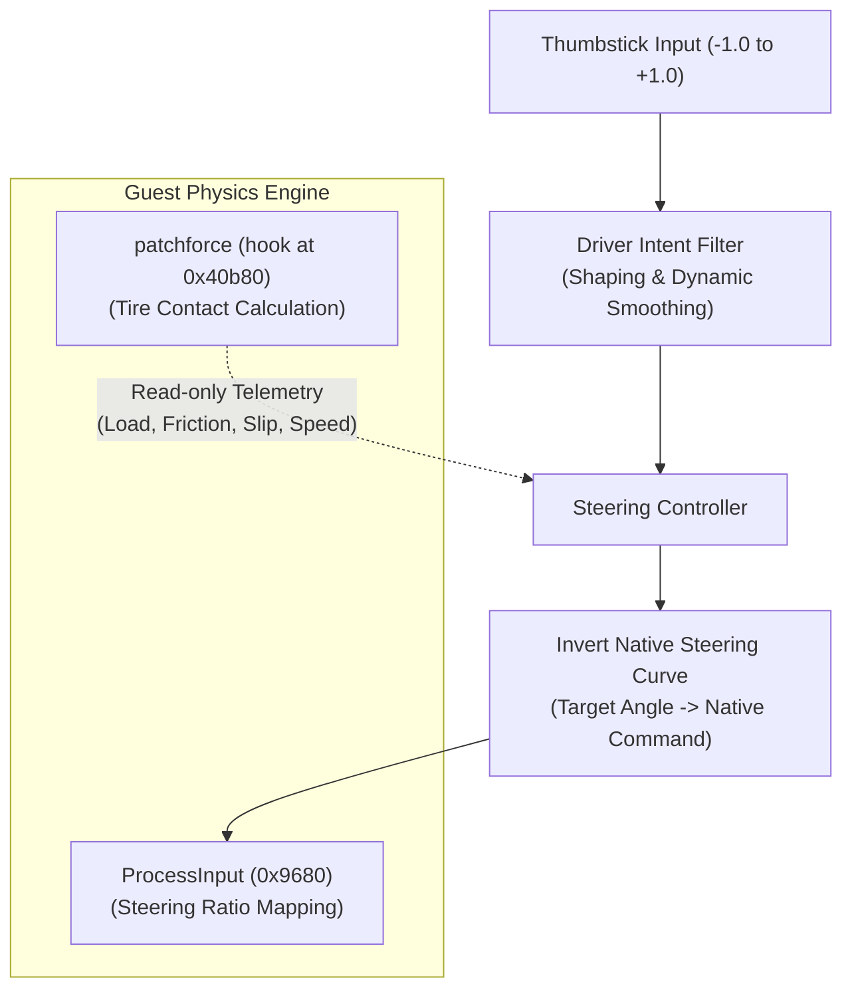

# Improved Analog Steering

The Improved Analog Steering option replaces the game's direct steering-angle mapping with a *Gran Turismo*-inspired control model. Instead of commanding a fixed wheel angle that can easily overwhelm the front tires, thumbstick deflection commands a fraction of the tires' live cornering grip, adjusting the wheel angle to match current speed and road conditions.

## Configuration and Activation

Set `M2_IMPROVED_ANALOG_STEERING=1` or enable **Improved Analog Steering** in the launcher's **Controls** tab (available in Original, Patched, and Custom profiles). It defaults to off and applies to the human player in both Arcade and Simulation modes.

It is disabled during replay playback, input recording (`--record-input`), and `m2ctl` control sessions. Digital D-pad steering and AI drivers always use the native steering path.

## Architecture and Guest Integration

The controller acts as a translation layer between thumbstick input and the native physics simulation. The guest engine retains full authority over vehicle dynamics, suspension geometry, tire relaxation, wear, and collisions.

### Guest Hook Points

1. **Input Interception (`ProcessInput`, `.text+0x9680`)**:
   Intercepts the player's car input record (`r6`) once per world update tick (~60 Hz) before native `adjustSteering` runs. When analog thumbstick input is active, it substitutes the computed steering command while leaving D-pad steering ramps untouched.

2. **Telemetry Observation (`patchforce` at `.text+0x40aa8`, hook at `.text+0x40b80`)**:
   Observes the player car's four contact patches immediately after native coefficient interpolation (`interpolate_coefficients`). It reads normal load ($F_z$), half-patch length ($a$), friction coefficients ($\mu_s, \mu_k$), carcass stiffness ($C$), contact velocities, and current wheel steer angles without modifying guest registers or memory. Wheel records (`car+0x04+i*4`) are paired with tire records (`car+0x14+i*4`) for the front (corners 0/1) and rear (corners 2/3) axles (`setup_wheels`, `.text+0x40570`).

3. **Steering Ratio Inversion**:
   The game maps raw steering commands to front wheel angles through an authored piecewise curve (`config+0x98..0xac`). The adapter inverts this curve at output so the guest receives the exact physical wheel angle requested by the controller.

## Live Cornering Force Model

To determine the wheel angle that produces the requested cornering force, the controller evaluates the game's contact-patch shear integral with combined longitudinal slip:

$$
\begin{aligned}
l &= \tan(\alpha) \\
q &= \sqrt{l^2 + k^2} \\
u &= \frac{q}{\rho} \cdot \frac{C \pi a^2}{2 \mu_s F} \\
x &= 1 - \frac{2}{1 + u^2} \\
F_y &= \frac{\mu_s F}{\pi} \left[ u (1 - x)^2 + \frac{\mu_k}{\mu_s} \left(\arcsin(x) + \frac{\pi}{2} + x \sqrt{1 - x^2}\right) \right] \frac{l}{q} \\
F_{\text{turn}} &= (1 - k) \, F_y \cos(\alpha)
\end{aligned}
$$

| Parameter | Meaning |
| :--- | :--- |
| $F$ | Normal contact load |
| $a$ | Half-patch contact length |
| $C$ | Carcass stiffness |
| $\mu_s, \mu_k$ | Static and sliding friction coefficients (surface grip, temperature, and wear) |
| $\rho$ | Rolling-to-travel ratio |
| $k$ | Longitudinal slip ratio (braking or wheelspin) |
| $\alpha$ | Tire slip angle |

### Peak Force Search

Wheel-local lateral force often has no finite peak (see [Slip-Angle Maxima and Force Direction](../game/tires-and-suspension.md#slip-angle-maxima-and-force-direction)). The controller instead maximizes the turning force perpendicular to the contact travel direction ($F_{\text{turn}}$), which accounts for braking or acceleration slip ($k$).

When tire parameters change, the solver scans a cached 128-interval grid from $0^\circ$ to $60^\circ$ and refines the peak with 32 golden-section iterations.

## Control Pipeline

### 1. Stick Shaping
Thumbstick deflection passes through a power curve to soften sensitivity around center for high-speed adjustments while keeping full authority at full lock:

$$\text{intent} = \operatorname{sgn}(\text{stick}) \cdot |\text{stick}|^{1.6}$$

### 2. Dynamic Intent Smoothing
Driver intent is filtered exponentially with separate time constants: slowest on turn-in (`kInputTime`), faster when releasing or counter-steering (`kUnwindTime`), and fastest when returning to center (`kCenterTime`).

### 3. Force-to-Slip Mapping
Driver intent magnitude ($0.0 \dots 1.0$) requests that fraction of the front tires' peak cornering force. The solver inverts the ascending branch of the turning-force curve to find the smallest slip angle that yields the requested force, combining the left and right front tire targets by dynamic normal load.

### 4. Contact Flow and Oversteer Alignment
The controller tracks the travel direction of each contact patch relative to the car body:

$$\text{flow} = \text{steer} - \arctan\left(\frac{v_{\text{lateral}}}{v_{\text{forward}}}\right)$$

Aligning the steering command with the front contact travel direction helps counter-steering and stops the wheel angle from feeding back into itself. When rear tire slip exceeds the rear grip peak, the excess blends in additional counter-steer alignment.

### 5. Low-Speed Blending and Fallback
Below the parking blend window, the controller uses direct geometric steering lock for tight maneuvers. Inside the window, a `smoothstep` curve transitions from geometric lock to grip-based slip steering. If front tire contact is lost (for example, when airborne, reversing, or fully locked under braking), the controller falls back to native proportional steering.

## Tuning Parameters

All response constants are defined in [`runtime/src/analog_steering.c`](../../runtime/src/analog_steering.c) and advance using the simulation world timestep (`world+0x10 * world+0x1c`, nominally $6 \times 1/360\text{ s} = 1/60\text{ s}$):

| Parameter | Value | Purpose |
| :--- | :--- | :--- |
| `kStickPower` | `1.6` | Non-linear thumbstick response exponent. |
| `kInputTime` | `0.100 s` | Turn-in rise time (~230 ms to 90% target). |
| `kUnwindTime` | `0.030 s` | Release and reversal response time (~69 ms to 90%). |
| `kCenterTime` | `0.014 s` | Re-centering rate at neutral stick (~32 ms to 90%). |
| `kAlignmentTime` | `0.060 s` | Smoothing time for contact-travel alignment and oversteer recovery. |
| Parking Blend | `5 .. 25 ft/s` (3.4 .. 17 mph) | Speed window transitioning from geometric lock to grip-based steering. |

## Verification and Scope

See [`tests/README.md`](../../tests/README.md) (`m2_analog_steering`, `m2_control_modes`, `m2_steering_vehicle`) and [Tire Bench](tire-bench.md) (`m2_tire_probe`) for the unit, vehicle-simulation, and tire-force test harnesses.

Because the controller only maps thumbstick input to front-axle slip targets rather than acting as a whole-chassis stability control system, excessive throttle or abrupt weight transfer can still induce spins.
