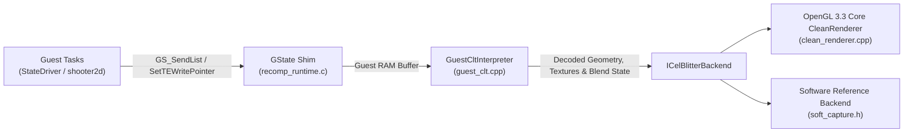

# Host CLT Interpreter, Rendering Backends, and Presentation

The graphics subsystem ([`host/graphics/`](../../host/graphics/) and [`shims/clt_registers.h`](../../shims/clt_registers.h)) translates 3DO M2 Triangle Engine (TE) command lists into OpenGL 3.3 Core draw calls. A CPU software rasterizer handles headless verification and capture.

## Command-List Submission Flow



1. **Guest Command Assembly**: Guest code writes big-endian 32-bit Command List Toolkit (CLT) instruction packets into double-buffered command lists allocated via `GS_AllocLists` (`8:2`).
2. **Dispatch and Handoff**: When flushes occur via `GS_SendList`, `TE_CMD_EXECUTELIST`, or `SetTEWritePointer`, the runtime passes the command buffer in guest RAM to `GuestCltInterpreter::interpret_clt()`.
3. **Host Interpretation and Emission**: [`GuestCltInterpreter`](../../host/graphics/guest_clt.cpp) decodes the packet stream, updates a virtual BDA register file, unpacks textures and palettes, and submits textured triangle primitives to the active blitter backend.

## Triangle Engine Command-List Interpreter (`GuestCltInterpreter`)

The M2 Triangle Engine instruction stream interleaves register-write headers (`RC_WRITE_REG`) with immediate vertex blocks (`RC_WRITE_VERTEX`).

### Register State Management

The interpreter maintains a 64 KiB virtual register bank across four functional groups:

| Register Group | Key Registers | Role |
| :--- | :--- | :--- |
| **Command Flow** | `DCNTL`, `DCNTLDATA` | Texture DMA triggers, branch/jump targets, synchronization barriers, and execution interrupts. |
| **Texture Engine** | `TXTLDCNTL`, `TXTADDRCNTL`, `TXTTABCNTL`, `TXTPIPCNTL` | Source memory addresses, texel formats, LOD dimensions, expansion masks, and 256-entry Pen Index Palettes (PIP). |
| **Destination Blender (DB)** | `DBUSERCONTROL`, `DBAMULTCNTL`, `DBDISCARDCONTROL`, `DBSRCBASEADDR` | Blend equations, alpha discard, depth/Z testing, color modulation, and framebuffer feedback. |
| **Vertex Engine** | `ESCNTL`, Vertex registers | Triangle strips and fans, screen-space coordinates, $1/W$ depth, vertex colors, and UV coordinates. |

### Texture Decoding and Caching

When an MMDMA texture load (`TXTLDCNTL`) executes, the interpreter reads source texels from guest RAM and expands them against the active palette in `TEPIPRAM` (`0x46000 .. 0x463FF`):

- **Supported Formats**: 1-bit, 2-bit, 4-bit, and 8-bit paletted textures, literal 16-bit `RGB555`, 16-bit `RGBA5551`, 32-bit `RGBA8888`, and hybrid formats with per-pixel Source Select Bit (`SSB`) transparency.
- **LOD and Mipmap Handling**: Scenery pages and textures retain their authored mip levels when byte footprints match `TXTUVMAX`, `TXTUVMASK`, and `TXTADDRCNTL.LODMAX`.
- **Multi-Level Caching**:
  - **MMDMA Texture Cache**: Stores up to 512 entries (128 MiB) keyed by source address, format, expansion flags, and palette checksum.
  - **Load Path Cache**: Retains up to 256 entries (64 MiB).
  - **TRAM Resident Pool**: Emulates the hardware 16-entry texture resident table using LRU eviction.
  - **Palette Re-expansion**: When palette entries change over identical texel indices, the interpreter re-expands and caches the updated RGBA chain without re-reading source guest memory.

### Framebuffer Copy-Back (`DBSRCBASEADDR`)

The game reads back the destination framebuffer as a texture source for menu screen wipes, rear-view mirror overlays, and car showroom reflections.

During the screen-rotation transition (`dorotatetrans`, `.text+0x33880`), the game draws 36 horizontal strips ($576 \times 12$) per frame that all sample from the same $576 \times 432$ source framebuffer. The host captures the source frame once per generation and slices each strip from the cached snapshot, avoiding 36 separate GPU readbacks per frame.

## Rendering Backends

All drawing commands route through [`ICelBlitterBackend`](../../host/graphics/cel_blitter.h):

### OpenGL 3.3 Core Renderer ([`CleanRenderer`](../../host/graphics/clean_renderer.cpp))
The default interactive renderer targeting desktop GPUs:
- **Scalable Framebuffers**: Renders offscreen into RGBA8 targets scaled by `M2_RENDER_SCALE` (up to $8\times$ native $640 \times 480$), with optional MSAA (`M2_ANTIALIASING=2..8`).
- **GLSL Core Shaders**: Implements perspective-correct $u/w, v/w, 1/w$ interpolation (with affine fallback for 2D UI quads), DB pixel discard rules (color zero, alpha zero, or SSB discard), and optional 16-bit RGB555 ordered dithering (`M2_RGB555_DITHER=1`) using the guest's $4 \times 4$ `DBDITHERMATRIXA/B` matrices.
- **Texture Filtering (`M2_TEXTURE_FILTER`)**:
  - `guest` (default): Honors the guest's per-draw filter state (nearest-neighbor for HUD sprites; bilinear for 3D track and car models).
  - `linear`: Forces bilinear filtering across all primitives, with optional anisotropic filtering (`M2_ANISOTROPY=2..16`).
  - `sharp`: Applies smoothstep-sharpened bilinear sampling in the fragment shader to keep pixel art crisp without shimmering.

### Software Reference Backend ([`SoftCaptureBackend`](../../host/graphics/soft_capture.h))
A CPU rasterizer that runs without an OpenGL context or display server. It handles `--headless` captures (`--capture DIR`, `--screenshot PATH`) and produces repeatable binary PPM images for regression tests.

### Fallback and Diagnostic Backends
`M2_GL_BACKEND=cel` selects the older cel blitter ([`gl_backend.cpp`](../../host/graphics/gl_backend.cpp)), which is also the fallback when `CleanRenderer` cannot initialize. `M2_GL_BACKEND=null` installs a no-op backend so CLT interpretation cost can be measured without GL submission.

## Presentation and Aspect Ratio

### 4:3 Aspect Ratio and Overscan Cropping

```text
+-------------------------------------------------------+
| Display Output (640 x 480)                            |
|   (CRT Overscan Margin - Cropped by default)          |
|                                                       |
|       +---------------------------------------+       |
|       | Guest Framebuffer (576 x 432)         |       |
|       | Origin: (32, 24)                      |       |
|       |                                       |       |
|       +---------------------------------------+       |
+-------------------------------------------------------+
```

The game's framebuffers are $576 \times 432$, and its `View` places them at $(32, 24)$ inside the $640 \times 480$ display output. By default (`M2_CROP_OVERSCAN=1`), the presenter crops the outer black margin and scales the $576 \times 432$ image to fill the 4:3 window. Setting `M2_CROP_OVERSCAN=0` displays the full $640 \times 480$ output.

### Custom Texture Replacements
[`TextureReplacements`](../../host/graphics/texture_replacements.h) matches decoded textures by dimensions and 64-bit FNV RGBA hash, allowing custom PNG textures (`M2_TEXTURE_REPLACEMENTS`) to be substituted at upload time.
